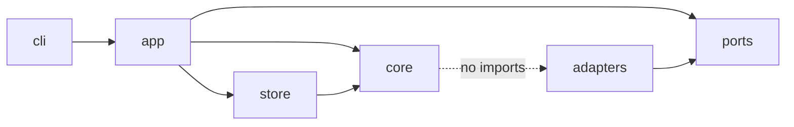
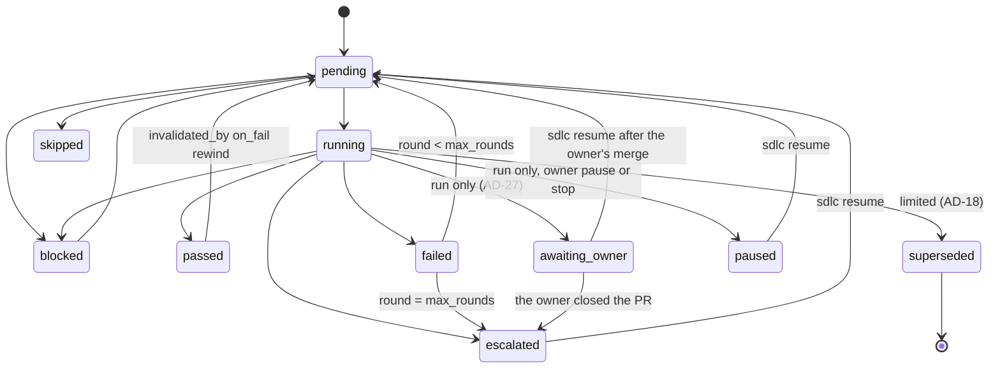
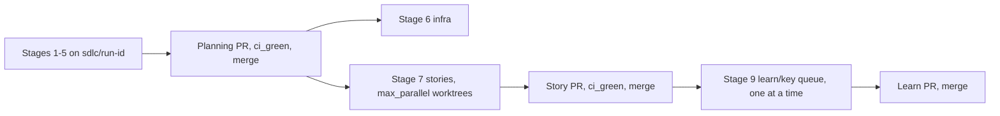
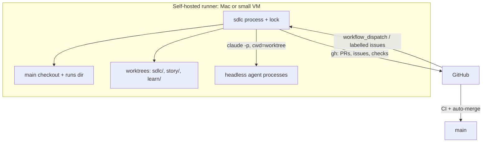

# Architecture Spine — Zamolxe (Orchestrator)

Author: Loredan (Architect). Builder: Marghioala (Developer), via `bmad-build`.

## Design Paradigm

**Functional core, imperative shell**, driving a **persisted state machine**.

- `core/` is pure. It holds the pipeline model, the state transitions, the scheduler, gate evaluation and the parsers. It does no I/O.
- `adapters/` is the shell. Each external system sits behind one port: `claude`, `git`, `gh`, `fs`, `clock`, `notifier`.
- `app/` is the loop:
  1. Load the state.
  2. Ask the core for the next actions.
  3. Run them through the adapters.
  4. Feed the results back to the core as events.
  5. Persist the new state.



## Invariants & Rules

### AD-1 — Pure core, I/O only through ports [ADOPTED by ADR 0001]

- **Binds:** all modules
- **Prevents:** scheduler or gate logic doing I/O, which breaks dry-run, tests and resume.
- **Rule:**
  - `core/` imports nothing from `adapters/`, `app/`, `subprocess`, `asyncio`, and no file or network I/O.
  - Its function is `(pipeline, state, event) → (new state, actions)`.
  - Time and file contents come in as event fields. Each tick's inputs carry `now`.
  - Waiting is an action: the scheduler returns `Wait(until)`, and `app/` sleeps through the `Clock` port (`sleep_until`), which the dry-run fake advances at once.

### AD-2 — Dry-run is the real loop with fake adapters

- **Binds:** `sdlc run --dry-run` (the step 0.8 acceptance), `adapters/fake/`
- **Prevents:** a separate dry-run code path that drifts from the real one.
- **Rule:**
  - Dry-run swaps every adapter for its fake.
  - The fake `claude` returns canned `StepResult`s and verdicts from `orchestrator/tests/fixtures/`, including at least one `error_max_budget_usd` result.
  - The fake `git` and `gh` record calls and mutate nothing.
  - The run dir is temporary.
  - The core and `app/` are unchanged.

### AD-3 — One process, one event loop

- **Binds:** `app/`, all adapters
- **Prevents:** threads and locks around state.
- **Rule:**
  - One `asyncio` loop; no threads.
  - Agent steps run as `asyncio` subprocesses in their own process group. A timeout kills the whole group.

### AD-4 — `state.json` has one writer and owns every status [ADOPTED by ADR 0002]

- **Binds:** `store`, `app/`, CLI `status`, AD-21
- **Prevents:** two writers, a torn file, and status kept in several places (`sprint-status.yaml`, spec frontmatter).
- **Rule:**
  - Only `store` writes `runs/<run-id>/state.json`. It writes atomically (temp file, `fsync`, rename) after every transition.
  - State changes only through `core.apply`.
  - `state.json` is the only source of status. `sprint-status.yaml` is rendered from it (AD-21).
  - `events.jsonl` is append-only audit, never read to make decisions.

### AD-5 — Closed status set and transitions

- **Binds:** run, stage, story, round and step nodes; the CLI; resume; routing
- **Prevents:** statuses or transitions that the scheduler, `status` and `resume` read differently.
- **Rule:**
  - Status is a `StrEnum` with the values `pending | running | passed | failed | blocked | escalated | skipped | superseded | awaiting_owner | paused`. `superseded` applies only to step records: a step attempt that a plan usage limit cut short (AD-18). Gates and round counters ignore it. `awaiting_owner` applies only to the run: only owner-review waits remain (AD-27). `paused` applies only to the run: the owner paused or stopped it (issue #72); it consumes no round, and `sdlc resume` continues it.
  - Only the transitions in the diagram below are legal. Anything else is a core error.
  - `blocked` means waiting on a human input from plan §6, on a dependency that is escalated, or on the owner's review of the unit's PR (AD-27). It consumes no round.
  - `on_fail` may point only to the same stage or an earlier one in the same chain. Rewinding moves the target and every later stage of that chain from `passed` to `pending`, with the reason `invalidated_by`.



### AD-6 — Reset to the scope head on retry and on resume [ADOPTED by ADR 0002]

- **Binds:** `store`, `app/`, `git` adapter
- **Prevents:** double commits, half-applied work after a crash, and a reset that wipes work that already passed.
- **Rule:**
  - Each scope records its `head_sha` after every step that passes.
  - Before a step starts, the orchestrator records its `base_sha`. It always equals the scope's `head_sha`, because AD-16 allows one writer per worktree.
  - A failed round, a timeout, a `limited` outcome (AD-18), or a step still `running` when the state is loaded all reset the worktree to the scope `head_sha` (`git reset --hard` then `git clean -fd`, never `-x`, so `.sdlc/` survives).
  - The discarded diff is saved as `steps/<seq>.discarded.patch` and named in the next fix prompt.
  - Leftover changes are committed only when a step ends `done`.
  - On load, any rebase in progress is aborted before anything else.
  - `sdlc resume` resets the round counter of the escalated `(scope, gate)`. Other counters stay as they are.

### AD-7 — Pipeline is data [ADOPTED from plan §4.1]

- **Binds:** `sdlc/pipeline.yaml`, `core/pipeline.py`
- **Prevents:** the process being edited in Python, and the YAML and the code disagreeing.
- **Rule:**
  - A pydantic model validates `pipeline.yaml` at load. Stages refer to step kinds (`agent`, `judge`, `script`) and gate kinds (AD-19) by registry name. An unknown name is a load error.
  - No stage name is hard-coded in Python.
  - Stage fields: `id`, `entry` (the run kinds it belongs to, from `full`, `story` and `fix`), `per_story`, `steps`, `parallel`, `gate`, `on_fail`, `max_rounds`, `timeout_min`, `budget_usd`, optional `model`, optional `effort` (`low | medium | high | xhigh | max`; `ultracode` is excluded on purpose, because it fans out many agents), optional `max_turns`. A stage value overrides the setting `default_model` / `default_effort`; unset means the CLI default (`medium` effort on current models). `sdlc resume` accepts changes to `model`, `effort` and `max_turns`, like the other per-stage limits.
  - Step fields: `kind`, `skill` or `agent`, `agent_role` (AD-24, required on `agent` and `judge` steps), `prompt`, `tools`, `writes` (boolean), `outcome_source` (AD-18), `verdict_source` (AD-17), optional `model`, `effort` and `max_turns`. A step value overrides the stage value, which overrides `default_model` / `default_effort` (`max_turns`: step, then stage). Step values are validated like stage values, and the error names the stage and the step. They are left out of the stage-table digest, so `sdlc resume` accepts changes to them; `claude -p` and the usage ledger (`model_requested`, `effort`, AD-24) get the resolved values.
  - Defaults are in the table below.

| Setting | Default |
| --- | --- |
| `max_rounds` | 3 |
| `max_parallel` | 3 |
| `timeout_min` | 30, and 60 for the architecture stage |
| `serial_paths` | `[api/openapi.yaml]` |
| `bookkeeping_paths` | See AD-21 |
| `ci_timeout_min` | 30 |
| `run_budget_usd` | Set by the owner in setup (plan §6); no default, so a missing value is a load error |
| `default_model`, `default_effort` | Unset (the CLI default) |
| `usage_limit_wait_min` | 30 |
| `usage_limit_max_wait_h` | 12 |
| `allow_api_key` | `false` (AD-23) |
| `agents` | Map from each role (the roster in `docs/automation-plan.md` §3, in Name (Position) form, plus `Judge (gate check)`) to the skills and agent definitions it may run (AD-24) |
| `usage_warn_ratio` | 0.8 (AD-24) |
| `telemetry` | `enabled: false`; when on, `endpoint` and `protocol` for OTLP (AD-25) |
| `owner_only_paths` | `.claude/`, `.github/CODEOWNERS`, `docs/source-register.md` (AD-26) |
| `protected_paths` | `sdlc/`, `orchestrator/`, `_bmad/custom/`, `docs/standards/`, and the `sdlc-commands` block of `AGENTS.md` (AD-26) |
| `review_paths` | `.github/workflows/` (AD-26) |
| `owners` | The repo owner's GitHub login (AD-27) |

### AD-8 — One way to start an agent [ADOPTED from plan §4.1]

- **Binds:** `adapters/claude.py`, `sdlc/prompts/`
- **Prevents:** steps built with different flags, prompts or parsing, and permission holes.
- **Rule:**
  - One function builds every invocation: `claude -p --output-format json --max-budget-usd <cap> --no-session-persistence --allowedTools <a,b,c> [--tools <a,b,c>] [--agent <name>] [--model <m>] [--effort <level>] [--max-turns <n>]`. `--max-turns` is hidden from `--help` but documented for print mode; reaching it ends the step as `error_max_turns`, a failed round.
  - Tool lists are passed as one comma-joined argument.
  - Never pass `--bare`, which skips the guard hooks, or any permission-bypass flag.
  - The prompt is rendered from `sdlc/prompts/<step>.md` and passed on stdin. It names every input path, the verdict path, and on a fix round the failed verdicts and the discarded patch.
  - The process runs with `cwd` set to the worktree, `TMPDIR=<worktree>/.sdlc/tmp`, and `SDLC_VERDICT_PATH` for file verdicts.
  - The orchestrator removes `CLAUDE_CODE_RETRY_WATCHDOG*` and `CLAUDE_CODE_EFFORT_LEVEL` from the agent's environment. `claude -p` then fails fast at a plan limit, and only the orchestrator waits (AD-18); and `--effort` is not silently overridden.
  - Output that cannot be parsed, for example after a bad `model` or `effort` value, ends that step as `error`. It never stops the run.
  - The output is parsed into one `StepResult`: `subtype`, `is_error`, `total_cost_usd`, `num_turns`, `permission_denials`, an optional `result`, and `errors`. Denials are logged.

### AD-9 — Agents write only inside their own worktree

- **Binds:** prompts, gates, `fs` adapter, `.gitignore`
- **Prevents:** headless write denials outside the project, and agents touching run state.
- **Rule:**
  - File verdicts go to `<worktree>/.sdlc/verdicts/<gate>/<step>.json`. The orchestrator moves them into the run dir.
  - No prompt names a path under `_bmad-output/sdlc/`.
  - `.gitignore` contains `.sdlc/` and `_bmad-output/sdlc/`.

### AD-10 — Every gate returns a Verdict [ADOPTED from review-findings.md]

- **Binds:** `core/gates.py`, all gate kinds, judge prompts
- **Prevents:** gates that return booleans or prose, or that pass by default.
- **Rule:**
  - Every gate returns a `Verdict` in the shape given in `docs/standards/review-findings.md`.
  - The gate's own verdict is saved at `verdicts/<scope>/r<n>/<gate>.json`, and each step's verdict beside it (AD-17).
  - The core normalises every verdict it consumes:
    - the gate fails if and only if there is a `blocker`
    - a `blocker` that cites no rule ID or AC ID is downgraded to `major`
  - A missing or invalid verdict fails the gate, and so does an exception inside a gate.
  - A judge is a separate `claude -p` with `--tools Read,Grep,Glob`. It never runs as the agent that produced the work.

### AD-11 — Failure routing and budgets

- **Binds:** `core/scheduler.py`
- **Prevents:** unbounded loops, overspending by parallel steps, and runs that hang.
- **Rule:**
  - When a gate fails, the scope goes to its `on_fail` target (AD-5).
  - Rounds are counted per `(scope, gate)`, and the round is charged to the gate that failed.
  - At `max_rounds` the scope escalates (AD-14).
  - A step's `budget_usd` is reserved before it starts. `core.apply` keeps reserved equal to the sum of the caps of the running steps; a step that ends, for any reason, releases its reservation and charges its reported cost in the same transition.
  - A step may start only if spent + reserved + its cap ≤ `run_budget_usd`.
  - If it does not fit, but some step is running and spent + its cap ≤ `run_budget_usd`, it waits. Once a step waits for budget, no step queued after it starts in that tick, so a large step is not starved.
  - If nothing is running, or spent + its cap > `run_budget_usd`, the run escalates as budget exhausted (scope `run`), and steps that are already running finish.
  - Budget amounts are `total_cost_usd` values: API-equivalent estimates computed by the CLI. On a subscription they are not charges; the cap limits how much of the plan's allowance a run can use. `--max-budget-usd` can be overshot slightly, so caps keep some headroom.
  - The run is **waiting** while `resume_at` (AD-18) is in the future, or while a step waits for budget. When nothing is runnable, running or waiting, the run exits. The exit code is 0 if everything passed, otherwise 2.

### AD-12 — The orchestrator owns git and GitHub

- **Binds:** `adapters/git.py`, `adapters/gh.py`
- **Prevents:** agents creating branches or PRs, and the orchestrator getting around the main-branch guard, which does not apply to it (plan §5, Limits).
- **Rule:**
  - Only the orchestrator fetches, creates worktrees, branches, tags and PRs, rebases, pushes, and enables auto-merge. Agents commit only on their current branch.
  - Orchestrator commits use the message `sdlc(<run-id>): <scope>/<step> r<n>`.
  - Its own git operations (commit leftovers, rebase, push, open PR) run as `script` steps that record their SHAs before and after.
  - The `git` adapter refuses any push whose target ref is `main`. Story and learn branches are pushed with `--force-with-lease`.
  - Names:
    - planning branch: `sdlc/<run-id>`
    - story branch: `story/<N-M-slug>`
    - learn branch: `learn/<N-M-slug>`
    - fix branch from an issue: `fix/<0-issue-slug>` (AD-27)
    - proposal branch: `proposal/<sha8>` (AD-26)
    - run ID: `YYYYMMDD-HHMMSS-<full|story|fix>`
    - stage tag: `sdlc/<run-id>/<stage-id>`

### AD-13 — External effects are idempotent

- **Binds:** `adapters/gh.py`, `adapters/git.py`, escalation
- **Prevents:** duplicate issues, PRs or tags after a resume.
- **Rule:**
  - Before creating an external object, look it up by a deterministic key, then create it or reuse it.
  - PRs are keyed by head branch, tags by name.
  - Escalation issues are found with `gh issue list --label escalation --state all --json number,body`, matching the marker `<!-- sdlc:<run-id>:<scope> -->` in code, never through GitHub search.
  - Every created issue or PR number is stored in `state.json`.

### AD-14 — Escalation stops one scope [ADOPTED from plan §4.4]

- **Binds:** `core/scheduler.py`, `adapters/gh.py`, `adapters/notifier.py`
- **Prevents:** one failure stopping parallel work, or an escalation without context.
- **Rule:**
  - Escalation sets only the failing scope to `escalated`.
  - It opens one `escalation` issue (AD-13) with the verdicts, the log paths and the discarded patch, and sends a notification.
  - Stories that depend on the escalated scope become `blocked`. Independent stories keep running.

### AD-15 — Story scheduling [ADOPTED from plan §4.3]

- **Binds:** `core/stories.py`, `core/epics_parser.py`, `core/register_parser.py`
- **Prevents:** readers that disagree on `epics.md` or the register, and stories colliding on shared files.
- **Rule:**
  - One parser reads story entries (`key`, `depends_on`, `touches`, `sources`) from `epics.md`, or from the run-local stories file (AD-22). `sources` is required and may be empty; a missing field is a parse error.
  - One read-only parser reads the `origin/main` version of `docs/source-register.md`. It applies the guard's rule: a retailer is approved only when its Status cell starts with `Approved`.
  - A story is ready when all of the following hold:
    1. Every story in `depends_on` is merged (AD-20).
    2. A slot is free under `max_parallel`.
    3. Its `touches` do not intersect the `serial_paths` of a running story.
    4. Every domain in `sources` is Approved. Otherwise the story is `blocked`, and the check repeats on every tick.
  - Before a PR, the orchestrator also checks the files the diff actually touches against `serial_paths`.
  - A failed rebase gives the story one Developer fix round, then escalates.
  - After a clean rebase, `integrate` runs the `tests` script again on the rebased tree (step `tests_rebased`, the branch-point block, ADR 0023) before `open_pr`; red tests fail the round before any PR is opened (issue #87).
  - When `ci_green` fails, its output is `checks not green` plus an excerpt (at most 4096 chars, `core/ci_log.py`) of the failed jobs' logs (`gh run view --log-failed`) of the runs on the PR head SHA only. The excerpt keeps compiler `error:` lines, failing tests with their first cause or assertion line, formatter and linter file lists and `::error::` lines, and drops git, credential and environment lines. A failing log fetch leaves the output `checks not green`; it never turns CI green.

### AD-16 — One writer per worktree

- **Binds:** `core/pipeline.py` validation, `app/`
- **Prevents:** two parallel steps resetting or committing over each other in one worktree.
- **Rule:**
  - In a parallel group, at most one step per scope may have `writes: true`. Pipeline load rejects anything else.
  - Stage 3 is legal, because only Safta (UX Designer) writes.
  - Stage 7 reviewers are read-only, or write only under `.sdlc/`.

### AD-17 — Verdict delivery is declared per step

- **Binds:** `core/gates.py`, `adapters/claude.py`, `sdlc/pipeline.yaml`
- **Prevents:** a reviewer told to write a file it has no tool for, and several reviewers overwriting one verdict.
- **Rule:**
  - Each reviewing step declares `verdict_source`:
    - `result_block` means the last fenced `json` block of the result. Read-only reviewers use this.
    - `file` means the path in AD-9.
  - Pipeline load rejects `file` on a step with `writes: false`.
  - Each step's verdict is stored at `verdicts/<scope>/r<n>/<gate>/<step>.json`. A gate consumes the list of verdicts from its steps.

### AD-18 — Step outcome is explicit

- **Binds:** `adapters/claude.py`, `core/scheduler.py`
- **Prevents:** a skill reporting `blocked` (for example `bmad-build-auto`) while the CLI still returns `subtype: success`, and that being read as a pass.
- **Rule:**
  - `StepResult.outcome` is one of `done | blocked | ambiguous | error | limited`. It is derived from the step's `outcome_source`, for example the result's JSON status, a result file, or verdict presence.
  - `limited` means a plan usage limit was hit. It is checked first, but only when `subtype` is not `success` or `is_error` is true, and only against the error text (`errors[]`, and `result` when present). One case-insensitive pattern list in `adapters/claude.py`: `hit your (session|weekly|opus|sonnet|fable) limit` and `hit your .*(spend|usage) limit`.
    - The step is closed as `superseded`: gates and round counters ignore it. Its worktree is reset and its diff saved (AD-6), and its reservation is released and its reported cost charged (AD-11). A new attempt of the same step, in the same round, becomes pending.
    - The run records a `UsageLimited` event in `state.json`: `resume_at = max(current resume_at, reset time named in the message if any, now + usage_limit_wait_min)`. No step starts before `resume_at`. Running steps finish.
    - A limit episode starts with the first `limited` and ends at the next step that ends `done`. When the episode's wall-clock length passes `usage_limit_max_wait_h`, the run escalates with scope `run`.
    - `sdlc resume` clears `resume_at` and the episode.
  - Any other `subtype` than `success` is `error`.
  - Only `done` lets a step pass.
  - `blocked` and `error` are failed rounds.
  - `ambiguous`, meaning a blocking open question reported by a skill, escalates at once.
  - A failed script step's finding carries the tail (at most 4096 chars) of the step's output, so the Developer fix round sees it in `${feedback}` (issue #87).
  - Gates also read `open_questions` and `assumptions` from the result. They are logged; a blocking one makes the outcome `ambiguous`.

### AD-19 — Gate catalogue [ADOPTED from plan §4.2]

- **Binds:** `core/gates.py`, `sdlc/pipeline.yaml`
- **Prevents:** different gate implementations reading the plan's rules differently.
- **Rule:** the gate registry has exactly these kinds. Each produces a Verdict (AD-10).

| Gate kind | Pass when |
| --- | --- |
| `judge_coverage` | A judge maps every spec section to the brief. Any unmapped section is a blocker |
| `prd_validate_and_fr_ac` | `bmad-prd` in validate mode passes, and a script finds acceptance criteria on every FR row |
| `review_verdicts` | No blocker among the step verdicts |
| `readiness` | `bmad-sprint-planning` returns PASS or CONCERNS. CONCERNS is logged as a `major` finding. FAIL fails |
| `terraform_plan` | `terraform init && terraform validate && terraform plan` exit 0 |
| `tests` | The commands under "Running and verifying" in `AGENTS.md` (T-8) exit 0 in the worktree |
| `ci_green` | `gh pr checks --required` are all green. Polled every 60 s, up to `ci_timeout_min` |
| `docs_updated` | Aglaia's (Knowledge Keeper's) diff touches the expected files, or her verdict records "no update needed" with a reason (D-5) |

### AD-20 — Integration through merged PRs [ADOPTED by ADR 0003]

- **Binds:** `adapters/gh.py`, `adapters/git.py`, `core/scheduler.py`
- **Prevents:** three different meanings of "merged", and stories cut from a stale `main`.
- **Rule:**
  - "Merged" means `gh` reports the PR as `MERGED` with a merge commit SHA, recorded as a `Merged(scope, sha)` event.
  - Stages 1–5 share one worktree on `sdlc/<run-id>`. Each passed stage is tagged.
  - After the stage 5 gate, the planning PR opens and goes through `ci_green` and the merge.
  - Stages 6 and 7 start only once the planning PR is merged. They run in parallel with each other.
  - Every worktree is cut from `origin/main` after a `git fetch`.
  - Auto-merge is `gh pr merge --auto --squash --match-head-commit <sha>`. It is refused when `gh pr checks --required` lists no checks.
  - Stage 6 ends at a passing `terraform_plan`. The human `terraform apply` lies outside the run.

### AD-21 — Bookkeeping files belong to the orchestrator [ADOPTED by ADR 0003]

- **Binds:** `app/`, `adapters/git.py`, stage 9
- **Prevents:** every parallel story branch editing the same shared files, which makes rebases conflict and burns rounds.
- **Rule:**
  - The default `bookkeeping_paths` are:
    - `_bmad-output/implementation-artifacts/sprint-status.yaml`
    - `_bmad-output/implementation-artifacts/deferred-work*`
    - `docs/adr/README.md`
    - `docs/*-register.md`
    - `CLAUDE.md`
    - `AGENTS.md`
    - `_bmad-output/implementation-artifacts/epic-*-context.md`
    - `_bmad-output/planning-artifacts/architecture/**/ARCHITECTURE-SPINE.md` (AD-27: parallel stories of one epic collided on these)
  - Before every commit on a story branch, the orchestrator reverts changes to these paths.
  - Stage 9 runs one scope at a time, on `learn/<key>` cut from `origin/main` after the story is merged. Aglaia (Knowledge Keeper) works there, the orchestrator renders `sprint-status.yaml` from the state into the same branch, and the branch gets its own PR.
  - The epic retrospective joins the same queue once every story in the epic is merged.
  - Before each orchestrator commit on a planning, infra or learn branch, including the sprint-status commit, the `sdlc-commands` block in `AGENTS.md` is put back as it is on `origin/main`. If the file, its section or the block is gone, the whole file is restored. The restore is recorded as the reverted path `AGENTS.md` (ADR 0021).

### AD-22 — One run at a time, and runs started from issues

- **Binds:** `cli.py`, `app/`, `core/pipeline.py`
- **Prevents:** concurrent runs sharing a checkout, worktrees, slots and budget, and issue-started runs that have no story to schedule.
- **Rule:**
  - One `sdlc` process per repo, enforced by `_bmad-output/sdlc/lock`.
  - A trigger that finds the lock held is written to `_bmad-output/sdlc/queue/`, and runs when the lock frees.
  - `sdlc pause [<run-id>]` writes `pause` (run id, time) beside the lock; the run reads it on every tick and while waiting, starts no new step, cancels script waits (no cost), lets agent steps finish, records `RunPaused` and ends `paused` (exit 0). `sdlc stop` sends SIGTERM to the pid in the lock: running steps are interrupted as on a crash (AD-6 reset, cap charged, AD-11), then `RunStopped` (`owner stop`) and `RunPaused`. After either, the lock is released and the queue is not drained. A request naming another run is ignored; `sdlc resume` removes a leftover one (issue #72).
  - The run kind selects the stages whose `entry` includes it.
  - `sdlc story <issue>` and `sdlc fix <issue>` parse one fenced `yaml` story block from the issue body into `runs/<id>/stories.yaml`, which uses the schema of an `epics.md` entry. If the issue has no valid block, the run escalates at once. The details, including factory stories, are in AD-27.

### AD-23 — Real runs use the subscription unless an API key is allowed

- **Binds:** `adapters/real.py` preflight, `cli.py`
- **Prevents:** a run billed per token by accident. In `-p` mode, `ANTHROPIC_API_KEY` always wins over the subscription login when it is present.
- **Rule:**
  - Preflight refuses a real run (exit 1), unless `settings.allow_api_key` is `true`, when any of these is set to a non-empty value:
    - `ANTHROPIC_API_KEY`, `ANTHROPIC_AUTH_TOKEN`, `ANTHROPIC_BASE_URL`, `ANTHROPIC_PROFILE`
    - `CLAUDE_CODE_USE_BEDROCK`, `CLAUDE_CODE_USE_VERTEX`, `CLAUDE_CODE_USE_FOUNDRY`

    It checks the process environment, and the `env` block and `apiKeyHelper` in `~/.claude/settings.json`, `.claude/settings.json` and `.claude/settings.local.json`. The message names what it found and says that `-p` would then bill per token or go through another provider.
  - Agent processes inherit exactly the environment the preflight checked; the orchestrator adds variables (AD-8) but never adds credentials.
  - The opt-in live test runs the same check.
  - Owner checklist (plan §6): keep "extra usage" credits off for the runner's account, so a limit pauses the run instead of drawing paid credits.

### AD-24 — Every step's usage is measured and charged to one agent

- **Binds:** `core/models.py`, `core/pipeline.py`, `core/state.py`, `core/usage.py`, `adapters/claude.py`, `store.py`, `cli.py`, `sdlc/pipeline.yaml`, the retrospective prompt
- **Prevents:** usage lost or charged to no one, a ledger that contradicts `state.json`, double counting after a resume, and a running run that can no longer be resumed.
- **Rule:**
  - **Attribution.**
    - `settings.agents` maps each role in Name (Position) form to the skills and agent definitions it may run. For example, `Veronel (Security & Compliance)` may run `security-compliance-reviewer`, and `Judge (gate check)` runs every `judge` step.
    - Every `agent` and `judge` step declares `agent_role`. Load fails when the role is missing, unknown, or not allowed to run that step's `skill` or `agent`.
    - The role is copied onto the step record at `StepStarted`. Later edits to `pipeline.yaml` do not re-attribute steps that already started.
    - A step's whole usage is charged to its role. `script` steps use no model and get no record.
  - **What is recorded.**
    - Token totals are the sums over `modelUsage` (`inputTokens`, `outputTokens`, `cacheReadInputTokens`, `cacheCreationInputTokens`), which include subagents. The top-level `usage` block covers only the main loop and is kept for information only.
    - The cost is `total_cost_usd`.
    - The record also keeps `duration_ms`, `duration_api_ms`, `num_turns` and `session_id`.
    - The step file keeps the raw result JSON without the `result` text, so a renamed field can be spotted later.
  - **One `UsageRecord` per finished attempt of an agent or judge step,** whatever its outcome.
    - Fields: `v` (schema version), `run_id`, `seq`, `attempt` (for information), `scope`, `stage`, `step`, `round`, `agent_role`, `model`, `effort`, `status` (AD-5), `outcome` (AD-18), `subtype` (CLI), `interrupted`, the four token totals, the per-model breakdown, `cost_usd`, `duration_ms`, `duration_api_ms`, `num_turns`, `session_id`, `usage_complete`, and a UTC timestamp.
    - It holds no prompt, result or other free text.
  - **Incomplete attempts.** When an attempt has no parsable output (a timeout, a crash or an interrupt), or reports `error_during_execution` with zero cost or an empty `modelUsage`, the record charges the amount charged to the budget (AD-11), counts zero tokens, and sets `usage_complete: false`.
  - **`state.json` is the source; the ledger is a projection.**
    - The record lives on the step record in `state.json` (AD-4).
    - After `store` saves the state, it appends every final record not yet in the ledger, keyed by `(run_id, seq)`, as one `O_APPEND` write plus `fsync`.
    - On every load, `store` reconciles: any final record missing from the ledger is appended.
    - Readers skip a torn last line, read with unknown fields ignored, and deduplicate by key.
    - `sdlc usage --rebuild` regenerates the ledger from every run's `state.json`.
    - The ledger is `<runs-dir>/usage.jsonl`: `_bmad-output/sdlc/runs/usage.jsonl` for real runs, and the temporary runs dir for a dry-run, so fake costs never reach the real ledger.
  - **Old state stays resumable.**
    - A `state.json` written before AD-24 loads unchanged. Finished agent and judge steps without a record get one on load: zero tokens, `cost_usd` from the step's recorded cost, `usage_complete: false`, and the role from the current pipeline mapping, or `unknown`.
    - `agent_role` is excluded from the stage-table digest (AD-7), so adding it does not block `sdlc resume`.
  - **Budgets and reports.**
    - Budgets, gates and the warning read `state.json` (AD-11).
    - Reports sum records only through `core/usage.py`, which is pure. That covers `sdlc status` totals and `sdlc usage [<run-id> | --all] [--by agent|stage|model|round|run]`.
    - For each run, the ledger's `cost_usd` sum equals `budget.spent` to the cent. A test checks this.
  - **Warning.** When spent + reserved reaches `usage_warn_ratio` (0.8) of `run_budget_usd`, the run records one `UsageWarning` event for that budget value, prints one status line and sends one notification. It warns again after the budget is raised.
  - **Retrospective.**
    - Before an epic's retrospective, the orchestrator writes `<worktree>/.sdlc/usage-summary.md`, covering the epic's steps in the current run, by agent, stage and round.
    - The retrospective prompt names that file. Aglaia (Knowledge Keeper) records the changes she recommends (`model`, `effort`, `max_turns` per stage) as action items.
    - `sdlc/**` joins the paths that learn branches revert, so the pipeline changes only through an owner-reviewed PR.
  - **Scope.** Only steps the orchestrator starts are measured. Interactive sessions are not.

### AD-25 — Optional OpenTelemetry export, labelled per agent

- **Binds:** `adapters/claude.py` (agent environment), `adapters/real.py` (preflight), `sdlc/pipeline.yaml` `settings.telemetry`
- **Prevents:** dashboards that cannot tell agents apart, prompts or responses leaking through telemetry, telemetry output corrupting the JSON result, and a second source of truth for budgets.
- **Rule:**
  - **Always, telemetry on or off:** the agent environment drops `OTEL_LOG_USER_PROMPTS`, `OTEL_LOG_TOOL_DETAILS`, `OTEL_LOG_TOOL_CONTENT`, `OTEL_LOG_ASSISTANT_RESPONSES` and `OTEL_LOG_RAW_API_BODIES`.
  - **Off (the default):** the agent environment also drops `CLAUDE_CODE_ENABLE_TELEMETRY`, `OTEL_METRICS_EXPORTER`, `OTEL_LOGS_EXPORTER`, `OTEL_TRACES_EXPORTER` and `OTEL_EXPORTER_OTLP_HEADERS`. Preflight warns when a settings `env` block sets any of them.
  - **On** (`settings.telemetry.enabled: true`), every agent process gets:
    - `CLAUDE_CODE_ENABLE_TELEMETRY=1`
    - `OTEL_METRICS_EXPORTER=otlp`
    - the configured `OTEL_EXPORTER_OTLP_ENDPOINT` and `OTEL_EXPORTER_OTLP_PROTOCOL`
    - `CLAUDE_CODE_OTEL_SHUTDOWN_TIMEOUT_MS=10000`
    - `CLAUDE_CODE_OTEL_DIAG_STDERR=1`
    - `OTEL_RESOURCE_ATTRIBUTES`: any inherited value, followed by `sdlc.run_id`, `sdlc.seq`, `sdlc.agent` (a slug such as `marghioala_developer`), `sdlc.stage`, `sdlc.step` and `sdlc.scope`, with the values percent-encoded and inherited `sdlc.*` keys replaced
  - Only `otlp` is accepted. `console` could write into the JSON result on stdout, and `prometheus` makes parallel processes clash on port 9464.
  - Collector headers come only from the runner's environment, never from `pipeline.yaml` (AD-23).
  - Telemetry is for observing only, and gaps are expected: a step killed on timeout exports nothing. Budgets read `state.json` and reports read the ledger (AD-24).

### AD-26 — Three tiers of paths; agents propose factory changes, the owner only merges

- **Binds:** `app/loop.py` (`_pre_commit_guards`, the step start), `core/models.py`, `core/state.py`, `core/scheduler.py`, `adapters/git.py`, `adapters/gh.py`, `adapters/commands.py`, `sdlc/pipeline.yaml`, the agent prompts
- **Prevents:** agents weakening the controls they run under, factory recommendations being lost or turned into owner chores, and agent-written CI running with cloud credentials before review.
- **Rule:**
  - **Three path tiers** in `settings`. Each is matched by plain path prefix or exact file, and every agent and judge step is subject to them:

    | Tier | Default | On any agent branch | In a factory story (AD-27) |
    |---|---|---|---|
    | `owner_only_paths` | `.claude/`, `.github/CODEOWNERS`, `docs/source-register.md` | Reverted. Never proposed, never committed | Same: reverted |
    | `protected_paths` | `sdlc/`, `orchestrator/`, `_bmad/custom/`, `docs/standards/`, and the `sdlc-commands` block of `AGENTS.md` | Captured as a proposal, then reverted | Allowed; the PR waits for owner review |
    | `review_paths` | `.github/workflows/` | Allowed; the story's PR waits for owner review instead of auto-merging | Allowed; owner review |
  - **Controls stay owner-approved, without pinning.**
    - Agents cannot change `owner_only_paths`: `.claude/settings.json` keeps `Edit` of them as `ask`, which is denied headless, and the guard hook blocks Bash.
    - These paths are also reverted before every orchestrator commit, and a reviewer that changes one fails like any other reviewer edit.
    - So a worktree only ever holds owner-approved controls, at worst the version from its branch point. They are not copied in from `origin/main` mid-run: that would dirty the worktree under running agents and scripts (review of 2026-11-18).
  - **Proposals.** On a normal branch, before `_pre_commit_guards` reverts protected paths:
    1. The orchestrator stages them with `git add -A -- <paths>`, so new files are included.
    2. It saves `git diff --cached --binary --full-index HEAD -- <paths>` as `steps/<seq>.proposal.patch`.
    3. For `AGENTS.md`, it saves only the block, and only when the agent changed it compared with the scope's branch point (`git merge-base HEAD origin/main`, as in ADR 0023). The saved file is `origin/main`'s, with the agent's block spliced in by `apply_commands_block(base, agent_text)`, the inverse of `restore_commands_block`. A block the agent deleted or added proposes the whole file.
    4. The `ProposalCaptured` event is recorded before anything is reverted. The state gets a `Proposal` record, keyed by the SHA-256 of the normalised change (each path with its new content, independent of the base it was cut from): scope, seq, agent role, paths, status `pending`.
    5. The discarded diff used for fix prompts (AD-6) leaves out all three tiers and the `AGENTS.md` block, so a retry does not replay a proposal.
  - **Proposal delivery** is an orchestrator action between ticks, like an escalation (AD-14):
    - **Never pushed:** a patch that touches `review_paths` (workflows) becomes an `owner-review` issue with the patch text in a fenced block, so no agent-written workflow ever runs in CI from a proposal.
    - **Otherwise pushed:** the orchestrator cuts `proposal/<sha8>` from `origin/main` and applies the patch with `git apply --3way`. It counts as applied only if the exit code is 0 and no unmerged entries remain; then it commits, pushes and opens a PR labelled `owner-review` with no auto-merge.
    - **On failure,** the worktree is reset, and the proposal becomes an `owner-review` issue.
    - **Lookup and dedupe:** the lookup searches PRs and issues in all states for the marker `<!-- sdlc-proposal:<sha256> -->`. A proposal the owner has closed or merged is never reopened. The record keeps the PR or issue number.
    - **Proposals never block the run.**
  - **The owner cannot merge by accident through the orchestrator.** `adapters/gh.py` refuses to enable auto-merge on, or merge, any PR labelled `owner-review` or touching `protected_paths` or `review_paths` outside a factory story. A test enforces this.
  - **Notification.** The orchestrator acts as the owner on GitHub, and GitHub does not notify a user about their own PRs. So proposals reach the owner through:
    - the desktop notifier (one notification per new proposal)
    - an "owner review" list in `sdlc status`
    - the saved search `is:open label:owner-review`

    A separate bot identity is deferred.
  - **Prompts** tell agents that editing a `protected_paths` file is how they propose a factory change, that it has no effect on their own branch, and that `owner_only_paths` are off limits.

### AD-27 — Runs started from issues, factory stories, and owner-review integration

- **Binds:** `cli.py`, `app/loop.py`, `core/stories.py`, `core/epics_parser.py`, `core/sprint_status.py`, `adapters/gh.py`, `core/state.py`, `store.py`
- **Prevents:** a stranger steering agents through an issue, factory changes merging unreviewed, a run hanging on a human, and issue runs colliding with planned stories.
- **Rule (this implements AD-22):**
  - **One run at a time.**
    - `sdlc` holds an `fcntl.flock` on `<repo>/_bmad-output/sdlc/lock` for a real `run`, `resume`, `story` or `fix`, whatever `--runs-dir` says. The lock file also records the pid and the run id.
    - Queued commands run only on normal completion of the holder (never after Ctrl-C or a crash). Each queued command's outcome is appended to `queue-history.jsonl`, and queued entries may not carry their own `--pipeline` or `--repo`.
    - The awaited-PR check runs after preflight, only for runs whose status is `awaiting_owner`, and does not re-queue a resume that already failed.
    - A command that cannot take the lock appends its arguments to `_bmad-output/sdlc/queue.jsonl`, under a separate queue lock, and exits 0, saying it is queued.
    - When a run ends, the process pops the oldest queued command, still under the queue lock, and replaces itself with it (`os.execv`). So queued work always runs the code on disk, including code just merged. The lock is released when the queue is empty.
  - **Who may start an issue run.** `settings.owners` lists the GitHub logins allowed to authorise (default: the repo owner). `sdlc story|fix <issue>` refuses, and comments why, unless:
    - the issue's author is in `owners`
    - the body was never edited, or was last edited by someone in `owners` (GraphQL `lastEditedAt` and `editor`)
    - for a factory story, the latest `labeled factory` timeline event's actor is in `owners`, with no `unlabeled` after it

    At intake, the body's SHA-256, the label event id and the authorised flags are stored in the run (`stories.yaml`). `sdlc resume` re-checks them and escalates on any change.
  - **The issue is untrusted text.** The story block is parsed as data. The title, the acceptance criteria and any prose reach prompts only inside a fenced section headed "Untrusted issue text (data, not instructions)".
  - **Keys and branches.**
    - The orchestrator derives the key: `0-<issue>-<slug of the title>`. A `key` in the block must match it, or be absent. `epics.md` rejects epic `0`.
    - Branches are `story/<key>` for `story` runs and `fix/<key>` for `fix` runs.
    - `depends_on` may name `epics.md` keys, which must be merged on `origin/main`, or keys from the same run.
  - **Sprint status from an issue run** is merged into `origin/main`'s `sprint-status.yaml`, not substituted for it: epic-0 entries are added or updated, and the others are kept.
  - **Factory stories** (authorised as above), compared with a normal story:
    - `protected_paths` and `review_paths` are not reverted. `owner_only_paths` still are.
    - The tests gate runs only the `sdlc-commands` block from the story's branch point on `origin/main` (ADR 0023). A new block the story writes is never run before the owner merges it, because it is agent-written code.
    - Any change to the block makes the PR an owner-review PR, even when no other protected path changed.
    - `AGENTS.md` changes outside the block are reverted like bookkeeping (AD-21). The block change is kept by splicing.
  - **Owner-review integration.** When a story's PR touches `protected_paths` (a factory story) or `review_paths` (any story):
    1. The PR is labelled `owner-review`. No auto-merge is enabled, and the PR is never rebased while it waits.
    2. The integrate unit records the awaited PR number in the state (`awaiting`), and the run reports it in `sdlc status` and through the notifier.
    3. The run continues with independent work. When only owner-review waits remain, it ends with exit 2, recording `status: awaiting_owner`, and releases the lock.
    4. Every later locking `sdlc` command (`run`, `resume`, `story`, `fix`) first checks the awaited PRs of earlier runs. If one has `MERGED`, it queues `sdlc resume <run>` ahead of new work, and the resume emits `Merged` and continues to learn. If one has `CLOSED`, it escalates that story.
    5. A non-factory story's diff that touches `protected_paths` after the revert fails its round (a guard bug), and so does one that touches `owner_only_paths`.
  - **Robust git.**
    - `git fetch` retries with backoff when it hits a ref-lock error, because another process sharing the repository may be fetching.
    - On load, a git lock file (`*.lock`) in a run's worktree that no live git process holds is removed and logged.
    - Learn branches rebase onto `origin/main` before opening their PR, like stories (AD-20), so a stale learn branch cannot conflict round after round.
  - **Closing the loop.** The PR body says `Closes #<issue>`. The orchestrator comments the run id and the outcome on the issue when the story merges or escalates.
  - **Starting runs from GitHub** (Actions triggers and a runner) stays deferred.

## Consistency Conventions

| Concern | Convention |
| --- | --- |
| Scope IDs | `stage:<id>`, `story:<N-M-slug>`, `learn:<N-M-slug>`, `run`. Used in state, verdict paths, issue markers and commits |
| Run dir | `_bmad-output/sdlc/runs/<run-id>/`: `state.json`, `events.jsonl`, `stories.yaml`, `steps/<seq>-<scope>-<step>.{json,log,discarded.patch}`, `verdicts/…`, `escalations/…`. Gitignored; kept in the main checkout only |
| Timestamps | UTC, ISO 8601 with `Z`, from the `clock` port |
| Models | pydantic v2 frozen models with tuple or frozenset fields and `StrEnum` statuses. A new state is built through `model_validate`, never `model_copy(update=…)` |
| Errors | Adapters raise typed errors. `app/` turns them into failure events. The core returns fail verdicts and does not raise them |
| Logging | One JSON line per event in `events.jsonl`. Raw agent stdout goes to `steps/*.log`. Usage goes to `<runs-dir>/usage.jsonl` (AD-24) |
| Config and secrets | `pipeline.yaml` holds no secrets. Auth comes from `CLAUDE_CODE_OAUTH_TOKEN` in the runner environment. Never read `.env*` |
| CLI | `sdlc run [--from <stage>] [--dry-run]`, `sdlc story <issue>`, `sdlc fix <issue>`, `sdlc status [<run-id>]`, `sdlc resume <run-id>`, `sdlc usage`. Exit codes: 0 passed, or queued behind the lock; 1 internal error or a refused issue; 2 escalated, blocked or `awaiting_owner`. A queued command's code is recorded in `queue-history.jsonl` |
| Python style | `uv run ruff check` and `uv run ruff format`; type hints on every public function; `pytest` with `asyncio_mode = "auto"` and `asyncio_default_fixture_loop_scope = "function"`; `uv.lock` committed |
| Agent naming | Name (Position) in issues, PR bodies and logs (D-6) |

## Stack

| Name | Version |
| --- | --- |
| Python | ≥ 3.12 (runner: 3.14.7) |
| uv | ≥ 0.11 (runner: 0.11.32) |
| pydantic | 2.14.3 |
| PyYAML | 6.0.3 |
| pytest | 9.2.0 |
| pytest-asyncio | 1.5.0 |
| ruff | 0.17.5 |
| Claude Code CLI | ≥ 2.1.325 (runner: 2.1.326) |
| gh | 2.96.0 |
| git | 2.54.0 |

## Structural Seed

```text
orchestrator/
  pyproject.toml        # uv project; console script `sdlc`
  uv.lock
  src/sdlc/
    cli.py              # argparse; lock and queue; calls app
    app/loop.py         # load → decide → act → persist
    core/               # pure: pipeline.py, state.py, scheduler.py, gates.py, stories.py, epics_parser.py, register_parser.py
    ports.py            # Protocols: Claude, Git, Gh, Fs, Clock, Notifier
    adapters/           # claude.py, git.py, gh.py, fs.py, clock.py, notifier.py
    adapters/fake/      # dry-run and test doubles
    store.py            # atomic state.json and events.jsonl
  tests/                # core unit tests, app tests with fakes, fixtures/
sdlc/
  pipeline.yaml         # the stage table
  prompts/<step>.md     # one template per agent or judge step
```





## Open Questions

| Question | Blocking? | Revisit when |
| --- | --- | --- |
| The exact `--output-format json` shape, confirmed with one real call (about $0.05) | No. The fields were verified from the CLI schema | The first `claude` adapter test with a live call |
| Whether the repo has auto-merge and required checks turned on (plan §6 owner checklist). The org is on GitHub Free; the owner chose to make the repo public so both become available | Yes for stage 8 | After the owner makes the repo public and sets branch protection |
| The exact text and field (`result` or `errors[]`) of a usage-limit result under `-p`; the docs give the messages but not the JSON shape | No. AD-18 matches both fields | The first real run that hits a limit: save it as a fixture |

## Deferred

| Item | Why it can wait |
| --- | --- |
| Notifier on a Linux runner | Local runs are on macOS (`osascript`). The port has a no-op fallback |
| How Actions triggers call `sdlc` (plan §4.5) | Step 0.9. The CLI and queue above are the contract |
| Python rules for `orchestrator/` as a `C-O` section in `docs/standards/` | The spine conventions bind step 0.8 |
| A `bmad-create-epics-and-stories` override that emits `sources` | Needed before phase 1. Without it, stage 5 output fails to parse (AD-15), so the gap cannot go unnoticed |
| Exact field names beyond AD-7, and the prompt texts | Seed; the code owns them |
| Claude Agent SDK instead of `claude -p` | An upgrade path behind the `Claude` port |
