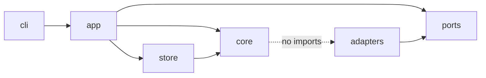
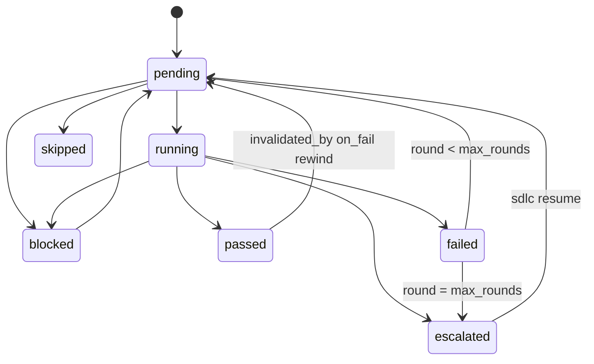
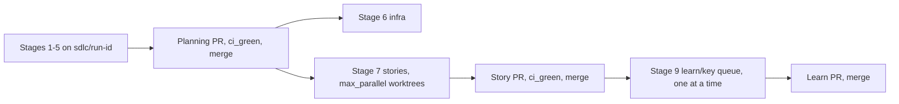
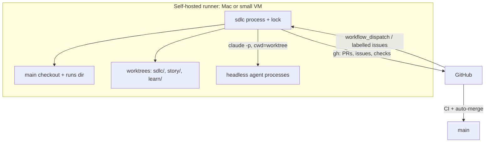

# Architecture Spine — Zamolxe (Orchestrator)

Author: Loredan (Architect). Builder: Marghioala (Developer), via `bmad-build`.

## Design Paradigm

**Functional core, imperative shell**, driving a **persisted state machine**.

- `core/` is pure. It holds the pipeline model, the state transitions, the scheduler, gate evaluation and the parsers. It does no I/O.
- `adapters/` is the shell. Each external system sits behind one port: `claude`, `git`, `gh`, `fs`, `clock`, `notifier`.
- `app/` is the loop:
  1. Load the state.
  2. Ask the core for the next actions.
  3. Run them through the adapters.
  4. Feed the results back to the core as events.
  5. Persist the new state.



## Invariants & Rules

### AD-1 — Pure core, I/O only through ports [ADOPTED by ADR 0001]

- **Binds:** all modules
- **Prevents:** scheduler or gate logic doing I/O, which breaks dry-run, tests and resume.
- **Rule:**
  - `core/` imports nothing from `adapters/`, `app/`, `subprocess`, `asyncio`, and no file or network I/O.
  - Its function is `(pipeline, state, event) → (new state, actions)`.
  - Time and file contents come in as event fields.

### AD-2 — Dry-run is the real loop with fake adapters

- **Binds:** `sdlc run --dry-run` (the step 0.8 acceptance), `adapters/fake/`
- **Prevents:** a separate dry-run code path that drifts from the real one.
- **Rule:**
  - Dry-run swaps every adapter for its fake.
  - The fake `claude` returns canned `StepResult`s and verdicts from `orchestrator/tests/fixtures/`, including at least one `error_max_budget_usd` result.
  - The fake `git` and `gh` record calls and mutate nothing.
  - The run dir is temporary.
  - The core and `app/` are unchanged.

### AD-3 — One process, one event loop

- **Binds:** `app/`, all adapters
- **Prevents:** threads and locks around state.
- **Rule:**
  - One `asyncio` loop; no threads.
  - Agent steps run as `asyncio` subprocesses in their own process group. A timeout kills the whole group.

### AD-4 — `state.json` has one writer and owns every status [ADOPTED by ADR 0002]

- **Binds:** `store`, `app/`, CLI `status`, AD-21
- **Prevents:** two writers, a torn file, and status kept in several places (`sprint-status.yaml`, spec frontmatter).
- **Rule:**
  - Only `store` writes `runs/<run-id>/state.json`. It writes atomically (temp file, `fsync`, rename) after every transition.
  - State changes only through `core.apply`.
  - `state.json` is the only source of status. `sprint-status.yaml` is rendered from it (AD-21).
  - `events.jsonl` is append-only audit, never read to make decisions.

### AD-5 — Closed status set and transitions

- **Binds:** run, stage, story, round and step nodes; the CLI; resume; routing
- **Prevents:** statuses or transitions that the scheduler, `status` and `resume` read differently.
- **Rule:**
  - Status is a `StrEnum` with the values `pending | running | passed | failed | blocked | escalated | skipped`.
  - Only the transitions in the diagram below are legal. Anything else is a core error.
  - `blocked` means waiting on a human input from plan §6, or on a dependency that is escalated. It consumes no round.
  - `on_fail` may point only to the same stage or an earlier one in the same chain. Rewinding moves the target and every later stage of that chain from `passed` to `pending`, with the reason `invalidated_by`.



### AD-6 — Reset to the scope head on retry and on resume [ADOPTED by ADR 0002]

- **Binds:** `store`, `app/`, `git` adapter
- **Prevents:** double commits, half-applied work after a crash, and a reset that wipes work that already passed.
- **Rule:**
  - Each scope records its `head_sha` after every step that passes.
  - Before a step starts, the orchestrator records its `base_sha`. It always equals the scope's `head_sha`, because AD-16 allows one writer per worktree.
  - A failed round, a timeout, or a step still `running` when the state is loaded all reset the worktree to the scope `head_sha` (`git reset --hard` then `git clean -fd`, never `-x`, so `.sdlc/` survives).
  - The discarded diff is saved as `steps/<seq>.discarded.patch` and named in the next fix prompt.
  - Leftover changes are committed only when a step ends `done`.
  - On load, any rebase in progress is aborted before anything else.
  - `sdlc resume` resets the round counter of the escalated `(scope, gate)`. Other counters stay as they are.

### AD-7 — Pipeline is data [ADOPTED from plan §4.1]

- **Binds:** `sdlc/pipeline.yaml`, `core/pipeline.py`
- **Prevents:** the process being edited in Python, and the YAML and the code disagreeing.
- **Rule:**
  - A pydantic model validates `pipeline.yaml` at load. Stages refer to step kinds (`agent`, `judge`, `script`) and gate kinds (AD-19) by registry name. An unknown name is a load error.
  - No stage name is hard-coded in Python.
  - Stage fields: `id`, `entry` (the run kinds it belongs to, from `full`, `story` and `fix`), `per_story`, `steps`, `parallel`, `gate`, `on_fail`, `max_rounds`, `timeout_min`, `budget_usd`, optional `model`.
  - Step fields: `kind`, `skill` or `agent`, `prompt`, `tools`, `writes` (boolean), `outcome_source` (AD-18), `verdict_source` (AD-17).
  - Defaults are in the table below.

| Setting | Default |
| --- | --- |
| `max_rounds` | 3 |
| `max_parallel` | 3 |
| `timeout_min` | 30, and 60 for the architecture stage |
| `serial_paths` | `[api/openapi.yaml]` |
| `bookkeeping_paths` | See AD-21 |
| `ci_timeout_min` | 30 |
| `run_budget_usd` | Set by the owner in setup (plan §6); no default, so a missing value is a load error |

### AD-8 — One way to start an agent [ADOPTED from plan §4.1]

- **Binds:** `adapters/claude.py`, `sdlc/prompts/`
- **Prevents:** steps built with different flags, prompts or parsing, and permission holes.
- **Rule:**
  - One function builds every invocation: `claude -p --output-format json --max-budget-usd <cap> --no-session-persistence --allowedTools <a,b,c> [--tools <a,b,c>] [--agent <name>] [--model <m>]`.
  - Tool lists are passed as one comma-joined argument.
  - Never pass `--bare`, which skips the guard hooks, or any permission-bypass flag.
  - The prompt is rendered from `sdlc/prompts/<step>.md` and passed on stdin. It names every input path, the verdict path, and on a fix round the failed verdicts and the discarded patch.
  - The process runs with `cwd` set to the worktree, `TMPDIR=<worktree>/.sdlc/tmp` and `SDLC_VERDICT_PATH`.
  - The output is parsed into one `StepResult`: `subtype`, `is_error`, `total_cost_usd`, `num_turns`, `permission_denials`, an optional `result`, and `errors`. Denials are logged.

### AD-9 — Agents write only inside their own worktree

- **Binds:** prompts, gates, `fs` adapter, `.gitignore`
- **Prevents:** headless write denials outside the project, and agents touching run state.
- **Rule:**
  - File verdicts go to `<worktree>/.sdlc/verdicts/<gate>/<step>.json`. The orchestrator moves them into the run dir.
  - No prompt names a path under `_bmad-output/sdlc/`.
  - `.gitignore` contains `.sdlc/` and `_bmad-output/sdlc/`.

### AD-10 — Every gate returns a Verdict [ADOPTED from review-findings.md]

- **Binds:** `core/gates.py`, all gate kinds, judge prompts
- **Prevents:** gates that return booleans or prose, or that pass by default.
- **Rule:**
  - Every gate returns a `Verdict` in the shape given in `docs/standards/review-findings.md`.
  - The gate's own verdict is saved at `verdicts/<scope>/r<n>/<gate>.json`, and each step's verdict beside it (AD-17).
  - The core normalises every verdict it consumes:
    - the gate fails if and only if there is a `blocker`
    - a `blocker` that cites no rule ID or AC ID is downgraded to `major`
  - A missing or invalid verdict fails the gate, and so does an exception inside a gate.
  - A judge is a separate `claude -p` with `--tools Read,Grep,Glob`. It never runs as the agent that produced the work.

### AD-11 — Failure routing and budgets

- **Binds:** `core/scheduler.py`
- **Prevents:** unbounded loops, overspending by parallel steps, and runs that hang.
- **Rule:**
  - When a gate fails, the scope goes to its `on_fail` target (AD-5).
  - Rounds are counted per `(scope, gate)`, and the round is charged to the gate that failed.
  - At `max_rounds` the scope escalates (AD-14).
  - A step's `budget_usd` is reserved before it starts. A step may start only if spent + reserved + its cap ≤ `run_budget_usd`. Otherwise the run escalates, and steps that are already running finish.
  - When nothing is runnable or running, the run exits. The exit code is 0 if everything passed, otherwise 2.

### AD-12 — The orchestrator owns git and GitHub

- **Binds:** `adapters/git.py`, `adapters/gh.py`
- **Prevents:** agents creating branches or PRs, and the orchestrator getting around the main-branch guard, which does not apply to it (plan §5, Limits).
- **Rule:**
  - Only the orchestrator fetches, creates worktrees, branches, tags and PRs, rebases, pushes, and enables auto-merge. Agents commit only on their current branch.
  - Orchestrator commits use the message `sdlc(<run-id>): <scope>/<step> r<n>`.
  - Its own git operations (commit leftovers, rebase, push, open PR) run as `script` steps that record their SHAs before and after.
  - The `git` adapter refuses any push whose target ref is `main`. Story and learn branches are pushed with `--force-with-lease`.
  - Names:
    - planning branch: `sdlc/<run-id>`
    - story branch: `story/<N-M-slug>`
    - learn branch: `learn/<N-M-slug>`
    - run ID: `YYYYMMDD-HHMMSS-<full|story|fix>`
    - stage tag: `sdlc/<run-id>/<stage-id>`

### AD-13 — External effects are idempotent

- **Binds:** `adapters/gh.py`, `adapters/git.py`, escalation
- **Prevents:** duplicate issues, PRs or tags after a resume.
- **Rule:**
  - Before creating an external object, look it up by a deterministic key, then create it or reuse it.
  - PRs are keyed by head branch, tags by name.
  - Escalation issues are found with `gh issue list --label escalation --state all --json number,body`, matching the marker `<!-- sdlc:<run-id>:<scope> -->` in code, never through GitHub search.
  - Every created issue or PR number is stored in `state.json`.

### AD-14 — Escalation stops one scope [ADOPTED from plan §4.4]

- **Binds:** `core/scheduler.py`, `adapters/gh.py`, `adapters/notifier.py`
- **Prevents:** one failure stopping parallel work, or an escalation without context.
- **Rule:**
  - Escalation sets only the failing scope to `escalated`.
  - It opens one `escalation` issue (AD-13) with the verdicts, the log paths and the discarded patch, and sends a notification.
  - Stories that depend on the escalated scope become `blocked`. Independent stories keep running.

### AD-15 — Story scheduling [ADOPTED from plan §4.3]

- **Binds:** `core/stories.py`, `core/epics_parser.py`, `core/register_parser.py`
- **Prevents:** readers that disagree on `epics.md` or the register, and stories colliding on shared files.
- **Rule:**
  - One parser reads story entries (`key`, `depends_on`, `touches`, `sources`) from `epics.md`, or from the run-local stories file (AD-22). `sources` is required and may be empty; a missing field is a parse error.
  - One read-only parser reads the `origin/main` version of `docs/source-register.md`. It applies the guard's rule: a retailer is approved only when its Status cell starts with `Approved`.
  - A story is ready when all of the following hold:
    1. Every story in `depends_on` is merged (AD-20).
    2. A slot is free under `max_parallel`.
    3. Its `touches` do not intersect the `serial_paths` of a running story.
    4. Every domain in `sources` is Approved. Otherwise the story is `blocked`, and the check repeats on every tick.
  - Before a PR, the orchestrator also checks the files the diff actually touches against `serial_paths`.
  - A failed rebase gives the story one Developer fix round, then escalates.

### AD-16 — One writer per worktree

- **Binds:** `core/pipeline.py` validation, `app/`
- **Prevents:** two parallel steps resetting or committing over each other in one worktree.
- **Rule:**
  - In a parallel group, at most one step per scope may have `writes: true`. Pipeline load rejects anything else.
  - Stage 3 is legal, because only Safta (UX Designer) writes.
  - Stage 7 reviewers are read-only, or write only under `.sdlc/`.

### AD-17 — Verdict delivery is declared per step

- **Binds:** `core/gates.py`, `adapters/claude.py`, `sdlc/pipeline.yaml`
- **Prevents:** a reviewer told to write a file it has no tool for, and several reviewers overwriting one verdict.
- **Rule:**
  - Each reviewing step declares `verdict_source`:
    - `result_block` means the last fenced `json` block of the result. Read-only reviewers use this.
    - `file` means the path in AD-9.
  - Pipeline load rejects `file` on a step with `writes: false`.
  - Each step's verdict is stored at `verdicts/<scope>/r<n>/<gate>/<step>.json`. A gate consumes the list of verdicts from its steps.

### AD-18 — Step outcome is explicit

- **Binds:** `adapters/claude.py`, `core/scheduler.py`
- **Prevents:** a skill reporting `blocked` (for example `bmad-build-auto`) while the CLI still returns `subtype: success`, and that being read as a pass.
- **Rule:**
  - `StepResult.outcome` is one of `done | blocked | ambiguous | error`. It is derived from the step's `outcome_source`, for example the result's JSON status, a result file, or verdict presence.
  - Any `subtype` other than `success` is `error`.
  - Only `done` lets a step pass.
  - `blocked` and `error` are failed rounds.
  - `ambiguous`, meaning a blocking open question reported by a skill, escalates at once.
  - Gates also read `open_questions` and `assumptions` from the result. They are logged; a blocking one makes the outcome `ambiguous`.

### AD-19 — Gate catalogue [ADOPTED from plan §4.2]

- **Binds:** `core/gates.py`, `sdlc/pipeline.yaml`
- **Prevents:** different gate implementations reading the plan's rules differently.
- **Rule:** the gate registry has exactly these kinds. Each produces a Verdict (AD-10).

| Gate kind | Pass when |
| --- | --- |
| `judge_coverage` | A judge maps every spec section to the brief. Any unmapped section is a blocker |
| `prd_validate_and_fr_ac` | `bmad-prd` in validate mode passes, and a script finds acceptance criteria on every FR row |
| `review_verdicts` | No blocker among the step verdicts |
| `readiness` | `bmad-sprint-planning` returns PASS or CONCERNS. CONCERNS is logged as a `major` finding. FAIL fails |
| `terraform_plan` | `terraform init && terraform validate && terraform plan` exit 0 |
| `tests` | The commands under "Running and verifying" in `AGENTS.md` (T-8) exit 0 in the worktree |
| `ci_green` | `gh pr checks --required` are all green. Polled every 60 s, up to `ci_timeout_min` |
| `docs_updated` | Aglaia's (Knowledge Keeper's) diff touches the expected files, or her verdict records "no update needed" with a reason (D-5) |

### AD-20 — Integration through merged PRs [ADOPTED by ADR 0003]

- **Binds:** `adapters/gh.py`, `adapters/git.py`, `core/scheduler.py`
- **Prevents:** three different meanings of "merged", and stories cut from a stale `main`.
- **Rule:**
  - "Merged" means `gh` reports the PR as `MERGED` with a merge commit SHA, recorded as a `Merged(scope, sha)` event.
  - Stages 1–5 share one worktree on `sdlc/<run-id>`. Each passed stage is tagged.
  - After the stage 5 gate, the planning PR opens and goes through `ci_green` and the merge.
  - Stages 6 and 7 start only once the planning PR is merged. They run in parallel with each other.
  - Every worktree is cut from `origin/main` after a `git fetch`.
  - Auto-merge is `gh pr merge --auto --squash --match-head-commit <sha>`. It is refused when `gh pr checks --required` lists no checks.
  - Stage 6 ends at a passing `terraform_plan`. The human `terraform apply` lies outside the run.

### AD-21 — Bookkeeping files belong to the orchestrator [ADOPTED by ADR 0003]

- **Binds:** `app/`, `adapters/git.py`, stage 9
- **Prevents:** every parallel story branch editing the same shared files, which makes rebases conflict and burns rounds.
- **Rule:**
  - The default `bookkeeping_paths` are:
    - `_bmad-output/implementation-artifacts/sprint-status.yaml`
    - `_bmad-output/implementation-artifacts/deferred-work*`
    - `docs/adr/README.md`
    - `docs/*-register.md`
    - `CLAUDE.md`
    - `AGENTS.md`
  - Before every commit on a story branch, the orchestrator reverts changes to these paths.
  - Stage 9 runs one scope at a time, on `learn/<key>` cut from `origin/main` after the story is merged. Aglaia (Knowledge Keeper) works there, the orchestrator renders `sprint-status.yaml` from the state into the same branch, and the branch gets its own PR.
  - The epic retrospective joins the same queue once every story in the epic is merged.

### AD-22 — One run at a time, and runs started from issues

- **Binds:** `cli.py`, `app/`, `core/pipeline.py`
- **Prevents:** concurrent runs sharing a checkout, worktrees, slots and budget, and issue-started runs that have no story to schedule.
- **Rule:**
  - One `sdlc` process per repo, enforced by `_bmad-output/sdlc/lock`.
  - A trigger that finds the lock held is written to `_bmad-output/sdlc/queue/`, and runs when the lock frees.
  - The run kind selects the stages whose `entry` includes it.
  - `sdlc story <issue>` and `sdlc fix <issue>` parse one fenced `yaml` story block from the issue body into `runs/<id>/stories.yaml`, which uses the schema of an `epics.md` entry. If the issue has no valid block, the run escalates at once.

## Consistency Conventions

| Concern | Convention |
| --- | --- |
| Scope IDs | `stage:<id>`, `story:<N-M-slug>`, `learn:<N-M-slug>`, `run`. Used in state, verdict paths, issue markers and commits |
| Run dir | `_bmad-output/sdlc/runs/<run-id>/`: `state.json`, `events.jsonl`, `stories.yaml`, `steps/<seq>-<scope>-<step>.{json,log,discarded.patch}`, `verdicts/…`, `escalations/…`. Gitignored; kept in the main checkout only |
| Timestamps | UTC, ISO 8601 with `Z`, from the `clock` port |
| Models | pydantic v2 frozen models with tuple or frozenset fields and `StrEnum` statuses. A new state is built through `model_validate`, never `model_copy(update=…)` |
| Errors | Adapters raise typed errors. `app/` turns them into failure events. The core returns fail verdicts and does not raise them |
| Logging | One JSON line per event in `events.jsonl`. Raw agent stdout goes to `steps/*.log` |
| Config and secrets | `pipeline.yaml` holds no secrets. Auth comes from `CLAUDE_CODE_OAUTH_TOKEN` in the runner environment. Never read `.env*` |
| CLI | `sdlc run [--from <stage>] [--dry-run]`, `sdlc story <issue>`, `sdlc fix <issue>`, `sdlc status [<run-id>]`, `sdlc resume <run-id>`. Exit codes: 0 passed, 2 escalated or blocked, 1 internal error |
| Python style | `uv run ruff check` and `uv run ruff format`; type hints on every public function; `pytest` with `asyncio_mode = "auto"` and `asyncio_default_fixture_loop_scope = "function"`; `uv.lock` committed |
| Agent naming | Name (Position) in issues, PR bodies and logs (D-6) |

## Stack

| Name | Version |
| --- | --- |
| Python | ≥ 3.12 (runner: 3.14.7) |
| uv | ≥ 0.11 (runner: 0.11.32) |
| pydantic | 2.14.3 |
| PyYAML | 6.0.3 |
| pytest | 9.2.0 |
| pytest-asyncio | 1.5.0 |
| ruff | 0.17.5 |
| Claude Code CLI | 2.1.325 |
| gh | 2.96.0 |
| git | 2.54.0 |

## Structural Seed

```text
orchestrator/
  pyproject.toml        # uv project; console script `sdlc`
  uv.lock
  src/sdlc/
    cli.py              # argparse; lock and queue; calls app
    app/loop.py         # load → decide → act → persist
    core/               # pure: pipeline.py, state.py, scheduler.py, gates.py, stories.py, epics_parser.py, register_parser.py
    ports.py            # Protocols: Claude, Git, Gh, Fs, Clock, Notifier
    adapters/           # claude.py, git.py, gh.py, fs.py, clock.py, notifier.py
    adapters/fake/      # dry-run and test doubles
    store.py            # atomic state.json and events.jsonl
  tests/                # core unit tests, app tests with fakes, fixtures/
sdlc/
  pipeline.yaml         # the stage table
  prompts/<step>.md     # one template per agent or judge step
```





## Open Questions

| Question | Blocking? | Revisit when |
| --- | --- | --- |
| The exact `--output-format json` shape, confirmed with one real call (about $0.05) | No. The fields were verified from the CLI schema | The first `claude` adapter test with a live call |
| Whether the repo has auto-merge and required checks turned on (plan §6 owner checklist) | Yes for stage 8, no for the step 0.8 dry-run | Step 0.9 |

## Deferred

| Item | Why it can wait |
| --- | --- |
| Notifier on a Linux runner | Local runs are on macOS (`osascript`). The port has a no-op fallback |
| How Actions triggers call `sdlc` (plan §4.5) | Step 0.9. The CLI and queue above are the contract |
| Python rules for `orchestrator/` as a `C-O` section in `docs/standards/` | The spine conventions bind step 0.8 |
| A `bmad-create-epics-and-stories` override that emits `sources` | Needed before phase 1. Without it, stage 5 output fails to parse (AD-15), so the gap cannot go unnoticed |
| Exact field names beyond AD-7, and the prompt texts | Seed; the code owns them |
| Claude Agent SDK instead of `claude -p` | An upgrade path behind the `Claude` port |
