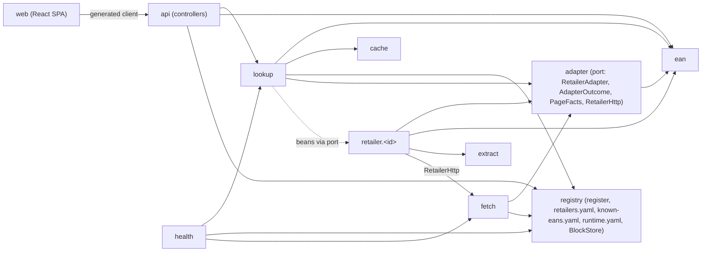
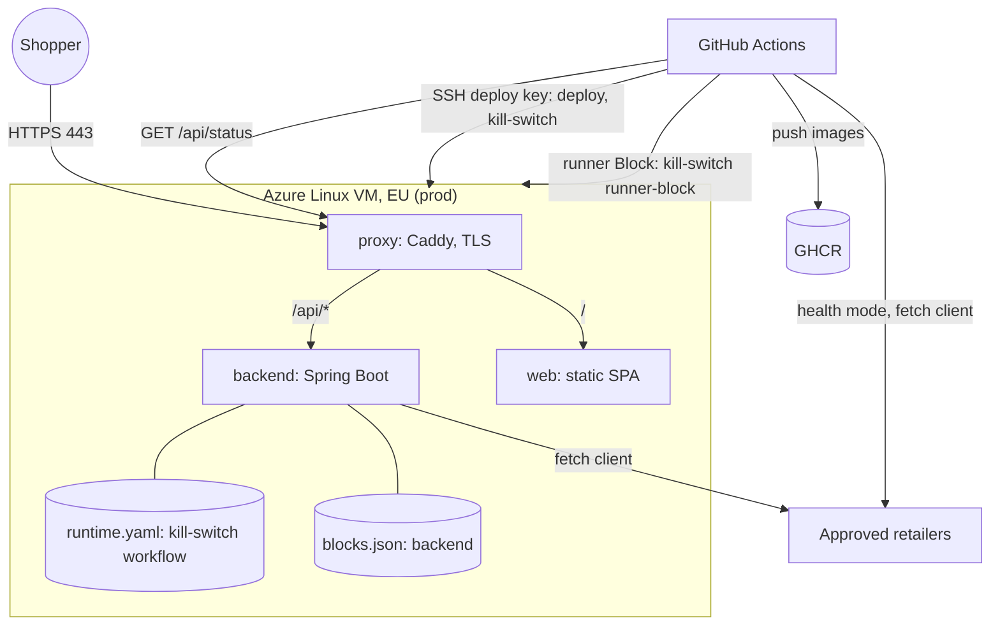
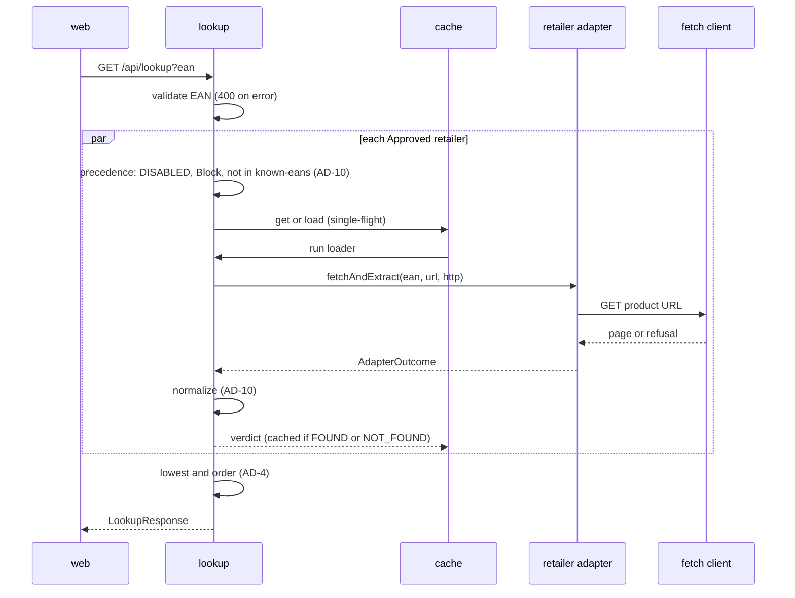

# Architecture Spine — price-checker

Author: Loredan (Architect), headless, run 20261117-174705-full, stage 4, round 2. Each AD names the ADR that records it (D-2).

## Design Paradigm

**Ports and adapters, in one backend process.** The `lookup` core decides everything about a Lookup: which rows, which status, which URL to fetch, cache, normalization, lowest price, order. It sees retailers only through the `RetailerAdapter` port, and the network only through the shared fetch client (`fetch`). Each `retailer.<id>` package is an adapter: it fetches one product page and extracts facts, and it knows nothing about other retailers, config, the cache or the API. The web app is a thin view over one generated API client; it formats, it does not decide.



Arrows are the only allowed dependencies between packages (AD-1); the dotted arrow is runtime wiring only — `lookup` sees adapters as `RetailerAdapter` beans and never imports a `retailer.<id>` class. `cache` depends on nothing in the app. `retailer.<id>` packages never depend on each other, on `lookup`, `cache`, `registry` or `api`.

## Invariants & Rules

### AD-1 — Package by feature, dependency direction enforced by tests (ADR 0006)

- **Binds:** all backend code; C-B1, C-5, C-12
- **Prevents:** retailer code leaking into the core, adapters calling each other, a second HTTP path.
- **Rule:** Root package `ro.pricechecker`; feature packages `api`, `ean`, `adapter` (the port types), `lookup`, `cache`, `registry`, `fetch`, `extract`, `health`, `retailer.<id>`. An ArchUnit test allows exactly the arrows in the paradigm diagram and forbids any HTTP client outside `fetch` (`java.net.http`, `URL#openConnection`, `URL#openStream`, `org.jsoup.Jsoup#connect`, any other client library); `extract` parses strings only. A source text-scan test fails when a retailer domain or a CSS selector string appears outside `retailer.<id>` and `config/`.

### AD-2 — One backend instance (ADR 0006) [ADOPTED]

- **Binds:** cache, rate limiters, Block state, deployment
- **Prevents:** two instances with separate limiters and caches, breaking S-3 and S-5.
- **Rule:** Exactly one backend container runs in production. Scaling out needs a new ADR.

### AD-3 — Contract-first API with two endpoints (ADR 0007) [ADOPTED C-3, C-W1]

- **Binds:** FR-1 to FR-5, AD-16, api, web
- **Prevents:** hand-written clients or handlers drifting from the contract.
- **Rule:** `api/openapi.yaml` is the only contract: `GET /api/lookup?ean={ean}` → `LookupResponse`; `GET /api/status` → `StatusResponse` (per Approved retailer: `retailerId`, `retailerName`, `enabled` (adapter enabled and fetching allowed), `blocked`, optional `notBefore` (AD-6); no prices). Spring interfaces and the TypeScript client are generated in the build, never committed or edited. Generated DTOs live in `api` only; `lookup` returns domain types that `api` maps.

### AD-4 — The server decides; the web app formats (ADR 0007)

- **Binds:** FR-3, FR-4, FR-5, AC-3.5, AC-N2.3, UX row order
- **Prevents:** lowest-price and ordering rules implemented twice and drifting.
- **Rule:** `lookup` returns rows in UX order (FOUND by price ascending, FOUND with no price, NOT_FOUND, UNAVAILABLE, DISABLED; ties by `retailerName`) and sets `lowest: true` on every row tied for the Lowest price (FOUND, price present, availability not OUT_OF_STOCK). The web app never re-sorts and never compares prices.

### AD-5 — Wire formats (ADR 0007)

- **Binds:** `LookupResponse`, `StatusResponse`, errors
- **Prevents:** float prices, ambiguous times, client errors that do not match server errors.
- **Rule:**
  - `ResultRow`: `retailerId` (register domain, e.g. `cel.ro`), `retailerName`, `status` ∈ {`FOUND`, `NOT_FOUND`, `UNAVAILABLE`, `DISABLED`}, `priceMinor` (integer bani, always RON; absent = price unavailable), `availability` ∈ {`IN_STOCK`, `OUT_OF_STOCK`, `UNKNOWN`}, `url`, `fetchedAt`, `lowest`. Non-FOUND rows carry only `retailerId`, `retailerName`, `status`, `lowest=false`. `LookupResponse` = `{ ean, rows }`.
  - Times are ISO-8601 UTC instants (`2026-11-17T12:05:00Z`). Only the web app converts to Europe/Bucharest.
  - Errors are RFC 9457 `application/problem+json` with `code` ∈ {`EAN_EMPTY`, `EAN_NON_DIGIT`, `EAN_LENGTH`, `EAN_CHECK_DIGIT`}; the web app maps the code to the same copy as its own check (UX Voice and Tone).
  - A failing retailer never makes the Lookup non-2xx (AC-5.4).

### AD-6 — The shared fetch client is the only way out, and it enforces S-1 to S-6 (ADR 0008)

- **Binds:** NFR-3, FR-9, FR-11, AC-2.4, AC-N3.8, C-12, S-1 to S-6
- **Prevents:** a rule enforced by one adapter and forgotten by another.
- **Rule:** An adapter receives a `RetailerHttp` bound to its retailer id; it cannot name a host. Before every request (robots.txt and redirects included) the client refuses, sending nothing, unless:
  1. the retailer is Approved in the bundled register and its adapter is enabled in `retailers.yaml` (AD-8);
  2. fetching is `allowed` in `runtime.yaml` and `BlockStore` reports no active Block (AD-9);
  3. the URL is `https` on the retailer's register domain or `www.` of it (redirects to any other host refused);
  4. robots.txt allows the path for our user agent — robots.txt is loaded single-flight per host on its first request, for the product token `price-checker`, cached 24 h (RFC 9309, story 2.5):

     | robots.txt result | Effect | Kept |
     |---|---|---|
     | Rule disallows the path | `Unavailable(BLOCKED)` (Block candidate) | 24 h |
     | Unparseable 2xx (NUL character, or no robots line) | every path disallowed, `BLOCKED` | 24 h |
     | Empty, or a 4xx other than 429 | every path allowed | 24 h |
     | Unreachable: 5xx, 429, timeout, I/O error, off-host or more than 3 redirects, no permit | `Unavailable(REFUSED)` for this request | not kept |

     The robots.txt fetch is never retried and `Crawl-delay` is ignored (the register sets the rate);
  5. `BlockStore.notBefore(retailer)` is not in the future (see 429 below);
  6. a rate-limit and concurrency permit is free before the deadline; every attempt, redirect and robots.txt fetch takes a permit; otherwise fail fast → `UNAVAILABLE` (S-5).

  It sends one fixed user agent containing the contact URL, no cookies, no login. At start it builds the full user agent (contact URL from config included) and refuses to start if the contact URL is missing or the string contains `bot`, `robot`, `crawl` or `spider` in any case. It retries only timeouts and 5xx, at most 2 times, with exponential backoff inside the deadline. On 429 it calls `BlockStore.recordRetryAfter(retailer, now + Retry-After)` (delta-seconds or HTTP-date; missing or unparseable → 60 s); if that time is within the request's deadline it waits and retries once, otherwise the row is `UNAVAILABLE`. `BlockStore.notBefore(retailer)` is the later of the value persisted in `blocks.json` (survives restarts) and `runtime.yaml` `notBefore` (a 429 the Health check runner saw, AD-16); a later 429 never moves it earlier. Until it passes, every request to that retailer, from any Lookup or the Health check, is refused without sending (`UNAVAILABLE`, not cached, not a Block). On 403 or a recognized challenge page it calls `BlockStore.record` and does not retry. It stamps `fetchedAt` and computes `notBefore` from the injected `Clock`. A stub-server test covers each refusal, including a second Lookup inside a long `Retry-After` sending nothing.

  Outcome mapping (one table for all adapters):

  | What happened | Recorded by | Row status |
  |---|---|---|
  | 200, product facts found | adapter → `Found` | `FOUND` (no price if price missing, null or non-RON) |
  | 200, page has no recognizable product facts | adapter → `Unavailable(UNPARSEABLE)` | `UNAVAILABLE` |
  | 404 or 410 on the curated URL | fetch → adapter → `NotFound` | `NOT_FOUND` |
  | timeout, 5xx after retries | fetch → `Unavailable(TIMEOUT \| HTTP_ERROR)` | `UNAVAILABLE` |
  | a check before sending fails (not Approved, adapter disabled, fetching stopped, off-host URL or redirect, no permit before the deadline, robots.txt unreachable); nothing sent | fetch → `Unavailable(REFUSED)` (story 2.4) | `UNAVAILABLE` |
  | 403, challenge page (generic markers in `fetch`), robots.txt disallows the path | fetch → `BlockStore.record` | `UNAVAILABLE` (Block, AC-11.1) |
  | 429 | fetch sets `notBefore`; waits and retries once only if `notBefore` is within the deadline; not a Block (AC-11.4) | as the retry ends, else `UNAVAILABLE` |
  | any request while `notBefore` is in the future | fetch refuses, sends nothing | `UNAVAILABLE` |

### AD-7 — Adapter contract (ADR 0012)

- **Binds:** every `retailer.<id>`, C-5, C-6, C-7, FR-3, AC-8.4
- **Prevents:** adapters returning different shapes, guessing prices, keeping extra page data, or resolving URLs their own way.
- **Rule:** One Spring bean per retailer implements `RetailerAdapter { String retailerId(); AdapterOutcome fetchAndExtract(Ean ean, URI productUrl, RetailerHttp http); }`. `AdapterOutcome` is sealed: `Found(PageFacts)`, `NotFound`, `Unavailable(UnavailableReason)` (enum). `PageFacts` holds only `priceMinor` (nullable), `currency`, `availability`, `url`, `eanOnPage` (nullable) — never name, description or image (S-7). Extraction uses the shared `extract` helpers in the order structured data → meta tags → the adapter's own selectors, each a separate tested function; an unparseable price is `null`, never 0. Adapters do not handle deadlines, cache, log, or read config. The application fails to start unless `retailers.yaml` ids and adapter beans match one-to-one.

### AD-8 — The bundled source register is the only compliance authority (ADR 0009)

- **Binds:** FR-9, AC-2.1, AC-9.1 to 9.4, AC-10.1, S-1
- **Prevents:** a runtime file, flag or env var enabling a non-Approved retailer (AC-9.3).
- **Rule:** The build copies `docs/source-register.md` into the backend artifact. One parser in `registry` reads `Domain` and `Status`; Approved only if Status matches `Approved YYYY-MM-DD`; any parse error approves nothing. The Result rows of a Lookup are exactly the `retailers.yaml` entries whose domain is Approved; an Approved retailer whose adapter is disabled gets a `DISABLED` row. A backend test fails when an entry with `adapter: enabled` is not Approved, an Approved retailer has no entry, `resolution` is missing or not in {`search`, `catalog`, `curated`}, the rate limit or the concurrency is looser than the register's Limits column, or that Limits value cannot be parsed for an entry that is `adapter: enabled` or Approved (ADR 0024). The same check (`registry.ConfigCheck`, which also covers `known-eans.yaml`: valid EANs, https URLs on the retailer's host, at least two distinct EANs per Approved retailer) runs when the `Registry` bean starts, and the backend refuses to start on any violation. Approval or retirement takes effect at the next deploy; the Kill switch is the immediate stop.

### AD-9 — Three config files, one writer each (ADR 0009)

- **Binds:** FR-7, FR-11, AC-7.1 to 7.5, AC-11.1, S-8, I-9
- **Prevents:** operator and app overwriting each other; a restart clearing a Block; a flipped kill-switch reading failing open.
- **Rule:**

  | File | Where | Only writer | Holds | Read |
  |---|---|---|---|---|
  | `config/retailers.yaml` | repo, in the artifact | developers, by PR | per retailer, keyed by `id` (register domain): `name` (planned; story 1.6 did not add it, so `retailerName` is the register domain until it exists), `adapter: enabled\|disabled`, `resolution`, `minIntervalMs`, `concurrency`, `deadlineMs` | start |
  | `config/known-eans.yaml` | repo, in the artifact | developers, by PR | per retailer id: list of `{ ean, url }` | start |
  | `runtime.yaml` | VM `/opt/price-checker/config/` | `kill-switch` workflow (write temp file, then `mv`) | per retailer: `fetching: allowed\|stopped`, `clearGeneration` (integer), optional `runnerBlock: { blockedAt, reason }`, optional `notBefore` (runner 429) | polled every 15 s, lazily: the first Lookup after 15 s on the injected `Clock` re-reads it, with no scheduler thread (story 2.3) |
  | `blocks.json` | VM volume `/opt/price-checker/state/` | backend `registry.BlockStore` only (whole-map atomic write) | per retailer: `blockGeneration`, `blockedAt`, reason, `notBefore` | start; then in memory |

  "Kill switch off" in the PRD means `fetching: stopped`. A retailer missing from `runtime.yaml` is stopped. An unparseable `runtime.yaml` keeps the last good settings and logs an error; with none since start, all are stopped. `BlockStore.record` re-reads `runtime.yaml` and sets `blockGeneration` = the larger of the polled and the file's `clearGeneration`, so a `clear-block` that has not been polled yet cannot cancel a new Block. Each `kill-switch` action changes only its own field for its own retailer and keeps every other field (`runnerBlock`, `clearGeneration`, `notBefore` included); the kill-switch script holds `flock` on the VM around read, edit and `mv`, then re-reads to verify its write; deploy never writes `runtime.yaml` (script tests check all three, including two concurrent actions). A Block is active while `blockGeneration >= clearGeneration` **or** `runnerBlock` is present for the retailer (a Block the Health check saw, AD-16); `BlockStore.isBlocked` answers both, so the fetch client, `lookup` and `/api/status` see one flag. `clear-block` increments `clearGeneration` and removes `runnerBlock`; it is the only way either kind of Block ends (AC-11.1). Only `BlockStore` reads or writes `blocks.json`.

### AD-10 — Row status precedence and normalization (ADR 0011)

- **Binds:** FR-2, FR-5, FR-6, FR-7, FR-10, FR-11, AC-3.5, AC-N2.3
- **Prevents:** a stopped or Blocked retailer showing a cached price; two places choosing a status.
- **Rule:** For each Approved retailer `lookup` decides, in order: adapter disabled or fetching stopped → `DISABLED`; active Block → `UNAVAILABLE`; EAN not in `known-eans.yaml` for that retailer → `NOT_FOUND`, no request; cache hit → cached verdict; else load. The load = `adapter.fetchAndExtract` then `normalize`: `eanOnPage` present and different → `NOT_FOUND`; currency not RON or price null → `FOUND` without price. Only `FOUND` and `NOT_FOUND` verdicts are cached (AC-6.3).

### AD-11 — Lookup execution and cache (ADR 0011)

- **Binds:** FR-2, FR-6, NFR-1, AC-2.2 to 2.4, S-3
- **Prevents:** concurrent Lookups fetching one page twice; one slow retailer delaying others.
- **Rule:** One virtual thread per retailer per Lookup. Each retailer has one `deadlineMs` (default 4000). `cache` is a generic Caffeine async cache keyed `(retailerId, ean)`, TTL 15 min (configurable), whose loader `lookup` supplies; the value is the normalized verdict: `status`, `priceMinor`, `availability`, `url`, `fetchedAt`. Concurrent misses share one in-flight load; the load owns its deadline from its start and is not cancelled when a waiting caller gives up; a caller whose own deadline passes returns `UNAVAILABLE` for that row only. Nothing else caches retailer data.

### AD-12 — EAN resolution: curated list for release 1 (ADR 0010)

- **Binds:** FR-10, FR-8, NFR-6, AC-10.1 to 10.5
- **Prevents:** a search request at evoMAG (robots.txt disallows it) or an unreviewed catalog source.
- **Rule:** Every retailer uses `resolution: curated`. `config/known-eans.yaml` is the curated map, the Health check list and the demo list; `lookup` reads it through `registry` and passes the URL to the adapter. `search` for one retailer needs a new ADR after its register row records the search route as allowed; `catalog` needs its own register row first.

### AD-13 — One EAN rule, implemented once per side (ADR 0007)

- **Binds:** FR-1, AC-1.1 to 1.6, S-11, T-7
- **Prevents:** client and server accepting different inputs.
- **Rule:** Trim leading/trailing whitespace (the ECMAScript `String.prototype.trim()` set: Unicode `Zs`, TAB, LF, VT, FF, CR, U+2028, U+2029, U+FEFF; not Java `strip()`; story 1.4), then: empty → `EAN_EMPTY`; any character other than ASCII `0-9` → `EAN_NON_DIGIT`; length not 8 or 13 → `EAN_LENGTH`; bad GS1 check digit → `EAN_CHECK_DIGIT`. `ean.Ean` and `web/src/ean.ts` implement it and both test suites run `api/ean-cases.json`. The server validates before any other work; `lookup` accepts only `Ean`.

### AD-14 — Logs hold an allowlist of fields (ADR 0017)

- **Binds:** NFR-5, AC-N3.7, AC-N5.2, AC-11.2, C-9, S-7, S-9
- **Prevents:** IPs, client user agents, raw user input or page content reaching a log.
- **Rule:** Application events go through `LookupLog` only: JSON lines on stdout with `ts`, `level`, `event`, `ean` (a validated `Ean` only), `retailer`, `outcome` (enum), `durationMs`. A rejected input logs `event=ean_rejected` with the `EAN_*` code as its `outcome` (no extra key), never the input. Exceptions log their type, not their message. Tomcat access logs off; Caddy has no access log and its own logs drop `remote_ip`, headers and URI. Blocks log at `WARN`. Platform logs that could hold client IPs stay off: no NSG flow logs, and no network diagnostics on the VM (Pacala (DevOps), stage 6).

### AD-15 — Deployment and operations (ADR 0015) [ADOPTED spec §10, I-1 to I-9]

- **Binds:** NFR-7, FR-7, I-1 to I-9, S-8, S-10, S-13
- **Prevents:** a second environment, hand changes, or ops actions needing SSH by a person or agent.
- **Rule:** One `prod` environment: one Azure Linux VM in an EU region with Docker Compose services `proxy` (Caddy 2, automatic HTTPS, port 80 redirects, `/api/*` → `backend:8080`, else → `web:8080`, `/data` on a volume), `web` (static SPA) and `backend`. Images built by GitHub Actions, pushed to GHCR, tagged with the git SHA, pulled with the workflow's short-lived `GITHUB_TOKEN` (logged out after). Only GitHub Actions reaches the VM by SSH: `deploy` (on merge to `main`) and `kill-switch` (workflow_dispatch for the operator: retailer, `allow` / `stop` / `clear-block`; and workflow_call for `health-check` only: retailer, `runner-block` with reason, or `runner-retry-after` with a time). Same origin for web and API; no CORS. How SSH is restricted (key-only sshd, a deploy user limited to the deploy and kill-switch commands, and the NSG rule for GitHub-hosted runners: opened just in time through OIDC, or a recorded accepted risk) is Pacala's (DevOps) stage 6 decision, recorded in an ADR.

### AD-16 — Health check: backend in `health` mode on a GitHub runner (ADR 0016)

- **Binds:** FR-8, AC-8.1 to 8.7, AC-11.2, I-10, T-3, T-6
- **Prevents:** a health check that skips fetch-client rules, hides a production Block, forgets a Block it saw, or is masked by a cache.
- **Rule:** `.github/workflows/health-check.yml` (daily cron at 04:00 Europe/Bucharest, and workflow_dispatch) reads production `GET /api/status` with `curl` (fails if unreachable). It fails, without fetching, every retailer that is `blocked` or has an open `adapter-broken` issue labelled `blocked` (a second record in case a hand-off failed). It writes a runner `runtime.yaml` with `fetching: allowed` only for the other `enabled` ones, copying each retailer's `notBefore`, so the runner's fetch client also waits out a production `Retry-After` (that retailer is reported as skipped, not failed). It then runs the backend built from `main` with the `health` profile: no web server, no cache (`lookup.KnownEanLoad` runs the adapter call and normalization without `ResultCache`; story 3.5), a fresh `blocks.json` (production Blocks already came through `/api/status`), the same `lookup` core, register and fetch client, with each retailer's rate interval doubled and concurrency 1 so the run leaves room for production traffic. It checks every Known EAN is `FOUND` with price, availability and URL, and robots.txt for every adapter path; it writes a report (retailer, EAN, missing fact, `blocked` flag) and the page passed through `fetch.PageStripper` (T-2), and exits non-zero on any failure. The hand-off is a separate job (`needs` the check job, `if: always()`), the only one holding the deploy secret; it reads the runner's `blocks.json` artifact, which `BlockStore` writes at the moment of each Block or 429, not the report, so it works even if the backend crashed later. For every retailer with a Block it calls `kill-switch` with `runner-block`, so production stops within one poll and every later run fails that retailer until an operator runs `clear-block` (AC-11.1, AC-11.2). For every retailer with a future `notBefore` it calls `runner-retry-after`, so production waits too (AC-11.4). Then, with `if: always()`, it opens or updates one `adapter-broken` issue per failing retailer with `gh`, labelled `blocked` for a Block, including when the hand-off failed. A missing or unparseable runner `blocks.json` or report fails the job and opens an issue for the operator. Any failed step fails the job.
- **Stripping:** `fetch.PageStripper` is the one function that turns a fetched page into an uploadable fixture: it removes `<script>` except JSON-LD product data, `<style>`, images and `srcset`, iframes, comments, and description text beyond 200 characters; a unit test proves it (S-7, T-2).

## Consistency Conventions

| Concern | Convention |
| --- | --- |
| Retailer id | The register `Domain` value exactly (`cel.ro`, `evomag.ro`). Java package: domain without dots (`retailer.celro`). Fixtures: `fixtures/<id>/`. |
| Naming | Glossary terms as written (`Lookup`, `ResultRow`, `RowStatus`, `KnownEan`). Enum values UPPER_SNAKE on the wire. |
| Money | Integer bani (`priceMinor`) in code and on the wire; page-text parsing only in `extract`; display `1.299,99 lei` via `Intl.NumberFormat('ro-RO')`. |
| Time | `java.time.Clock` injected (T-5); `Instant` in code and on the wire; Europe/Bucharest only in the web app. |
| Config | Spring `@ConfigurationProperties` records validated at start; env vars only for secrets and file paths (C-4). |
| Errors | Adapters return `AdapterOutcome`; only `fetch` and `lookup` turn exceptions into `UNAVAILABLE`; API errors are problem+json. |
| Tests | Names or tags carry the AC id (T-1): `@Tag("AC-6.3")` in JUnit, `it('AC-1.3 …')` in Vitest and Playwright. Adapter tests read `fixtures/<id>/` only (T-2, T-3). |
| Web state | Component state only; no state library, no router; `/?ean=` via `history.replaceState` on each valid submit (no `pushState`, no `popstate` handling); opening `/?ean=<valid>` fills the input and runs the Lookup, opening `/?ean=<invalid>` fills the input with no Lookup and no error (story 1.7); loading copy "Checking retailers…". |

## Stack

Versions were not checked on the web in this run (permission denied). Each row is the line to use; the scaffold story pins the current GA patch after a web check and updates this table.

| Name | Version |
| --- | --- |
| Java (Eclipse Temurin) | 21 LTS [ADOPTED] |
| Spring Boot | 4.1.2 (pinned in `backend/build.gradle.kts`, story 1.1) |
| Gradle wrapper (Kotlin DSL) | 9.9.1, distribution sha256 pinned (S-12) |
| Gradle foojay-resolver-convention (JDK 21 toolchain) | 1.0.0 |
| Caffeine | 3.x |
| jsoup | 1.24.1 (pinned in `backend/build.gradle.kts`, story 2.1) |
| crawler-commons (robots.txt) | 1.6 (pinned in `backend/build.gradle.kts`, story 2.5) |
| ArchUnit | 1.5.1 |
| Spotless (Gradle plugin) + google-java-format | 8.11.0 + 2.0.0 |
| OpenAPI Generator (`spring`, `typescript-fetch`) | 7.27.0 (Gradle plugin in `backend/build.gradle.kts`; `web/openapitools.json` via `@openapitools/openapi-generator-cli` 2.42.2, story 1.3) |
| Node.js | 24 LTS |
| TypeScript, React, Vite | current GA (React 19.x or newer) |
| Vitest, Testing Library, axe-core, Playwright, ESLint, Prettier | current GA |
| Caddy | 2.x; images `caddy:2.10.2` (proxy) and `caddy:2.10.2-alpine` (web image) (story 3.2) |
| Container base images | `eclipse-temurin:21.0.8_9-jdk-noble` / `-jre-noble` (backend), `node:24.11.1-bookworm-slim` and `openapitools/openapi-generator-cli:v7.27.0` (web build stages), exact tags checked by `DeployConfigTest` (story 3.2, S-12) |
| Terraform, azurerm provider | 1.x, 4.x |

## Structural Seed

```text
api/openapi.yaml            # the contract (AD-3)
api/ean-cases.json          # shared EAN validation cases (AD-13)
config/retailers.yaml       # static retailer config (AD-8, AD-9)
config/known-eans.yaml      # curated EAN→URL map; Health check and demo EANs (AD-12)
fixtures/<retailer-id>/     # recorded, stripped pages (T-2)
backend/                    # Spring Boot, Gradle wrapper; src/main/java/ro/pricechecker/<feature>/
web/                        # Vite + React + TypeScript; web/e2e/ Playwright
deploy/compose.yaml, deploy/Caddyfile   # prod stack and proxy (story 3.2)
backend/Dockerfile, web/Dockerfile, web/Caddyfile, .dockerignore  # images; build context is the repo root
infra/                      # Terraform (I-1)
.github/workflows/          # ci, terraform-plan, deploy, kill-switch, health-check
```





## Capability → Architecture Map

| Capability | Lives in | Governed by |
| --- | --- | --- |
| FR-1 EAN entry | `web/src/ean.ts`, `ean` | AD-13, AD-5 |
| FR-2 parallel lookup | `lookup` | AD-10, AD-11 |
| FR-3 facts per retailer | `retailer.<id>`, `extract`, web table | AD-4, AD-5, AD-7 |
| FR-4 lowest price | `lookup` | AD-4 |
| FR-5 failure containment | `lookup`, `fetch` | AD-5, AD-10 |
| FR-6 cache | `cache`, `lookup` | AD-10, AD-11 |
| FR-7 kill switch | `registry`, `kill-switch` workflow | AD-9, AD-15 |
| FR-8 health check | `health`, `health-check` workflow | AD-16 |
| FR-9 compliance gate | `registry`, `fetch`, register test | AD-6, AD-8 |
| FR-10 EAN resolution | `lookup`, `config/known-eans.yaml` | AD-10, AD-12 |
| FR-11 Block | `fetch`, `registry.BlockStore`, `kill-switch` `runner-block` | AD-6, AD-9, AD-16 |
| NFR-1 responsiveness | `lookup` | AD-11 |
| NFR-2 accuracy | `extract`, `lookup` | AD-7, AD-10 |
| NFR-3 polite fetching | `fetch` | AD-6 |
| NFR-4 accessibility | `web` | EXPERIENCE.md, ADR 0013 |
| NFR-5 privacy | logging, proxy | AD-14 |
| NFR-6 demo reliability | `config/known-eans.yaml`, `web/e2e` | AD-12, ADR 0013 |
| NFR-7 transport and supply chain | `deploy`, `infra`, CI | AD-15, ADR 0014, ADR 0024 |

## Deferred

- **Exact versions** — the scaffold story pins exact library versions and container base images (Temurin, Node, Caddy) by digest or exact tag after a web check, including a Spring Boot 4 + OpenAPI Generator compatibility spike; stage 7 checks it (S-12).
- **Azure region, VM size, DNS label** — Pacala (DevOps), within I-3 and I-8; bound: EU region and a DNS name Caddy can get a certificate for.
- **Secret and vulnerability scanners** — decided in story 1.9: gitleaks and Trivy in `.github/workflows/ci.yml` (ADR 0024); thresholds fixed in ADR 0014 (high and critical fail).
- **Search or catalog resolution** — needs a register row first (AD-12).
- **Product name in rows** — waits for the owner on S-7 (PRD §9 Q5).
- **UI component library** — none; DESIGN.md tokens as plain CSS.
- **Metrics and tracing** — none beyond logs and the Health check.
- **Staging environment** — none; CI uses stubs (T-3, T-4).
- **Gate commands** — proposed in ADR 0014; they enter the `sdlc-commands` block in `AGENTS.md` by a stage 9 PR, since a worktree may not change it (ADR 0004).
